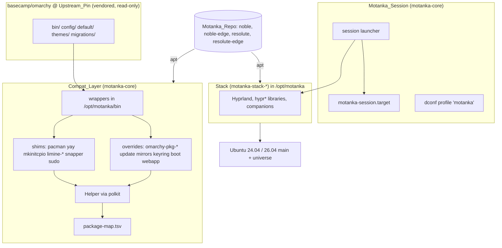
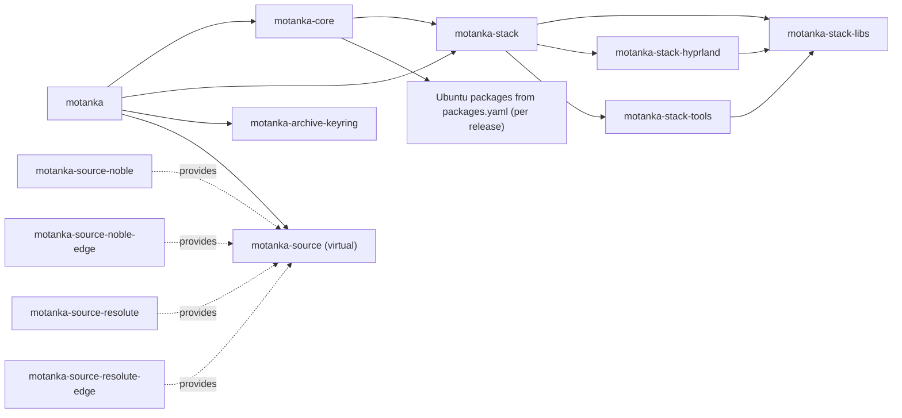
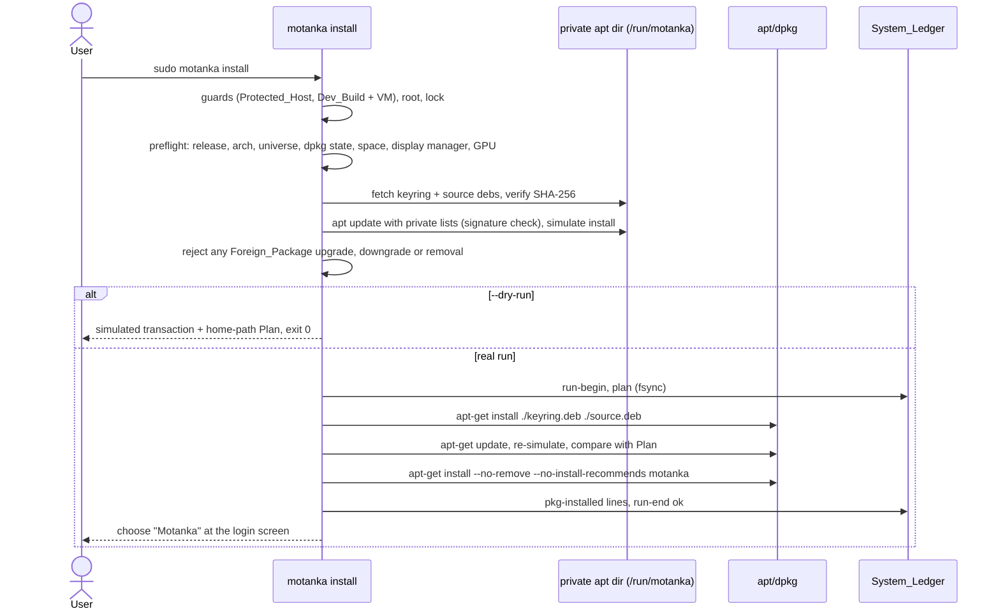
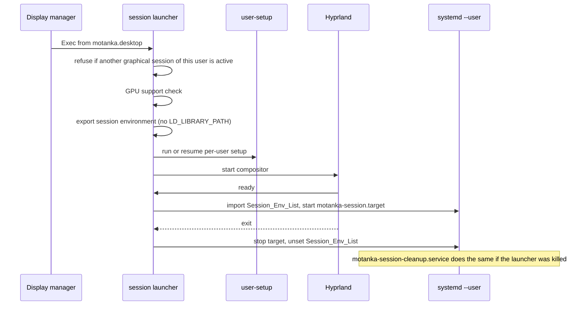
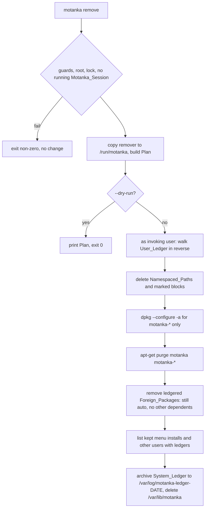
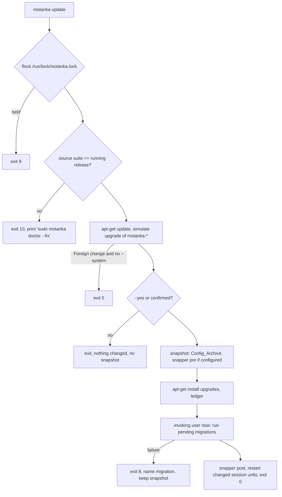

# Design Document: motanka-layer

## Overview

This design implements `requirements.md` (Requirements 1–14) on the architecture in `DESIGN.md`, including its "Linux practices" section.

- Upstream is vendored unmodified, read-only, under `/opt/motanka/share/omarchy`.
- A Compat_Layer of package map, wrappers, shims and overrides translates Upstream's Arch calls.
- The Stack ships under `/opt/motanka` and finds its libraries through RUNPATH.
- A separate Wayland session starts all of it. Its environment, services, dconf store and launchers stay inside that session.
- Every system change goes through apt and is recorded in the System_Ledger. Every planned home-folder change is ledgered before it happens, and a scan afterwards catches the rest.

Building the current Hyprland stack for Ubuntu 24.04 under `/opt/motanka` is not yet proven. Spike S1 settles it before any packaging task starts.

### Terms introduced by this design

- **Plan**: the list of actions a command computes before acting. `--dry-run` prints the Plan and stops.
- **Wrapper**: a generated launcher in `/opt/motanka/bin` for one Upstream command. It sets the wrapper scope and runs the override or the unmodified Upstream script.
- **Wrapper scope**: the environment a Wrapper sets: `PATH` with overrides, shims and Upstream `bin/` in front, and `OMARCHY_PATH`.
- **Session_Env_List**: the fixed list of variables the launcher imports into the systemd user manager and removes when the session ends.
- **Home_Path_Class**: the class of each home-folder target Upstream writes: `namespaced`, `session`, `app` or `shared`.
- **Call_Inventory**: the CI-generated list of every Arch-tool call, privileged call and home write in Upstream at a pin.
- **Config_Archive**: Motanka's snapshot: the installed Motanka .debs, their version list and a tar of each user's ledgered and Namespaced_Paths.

### Departures from DESIGN.md

| Departure | Reason |
|---|---|
| The apt source file is owned by one of four `motanka-source-<suite>` packages, not by the keyring package. | Requirement 11.2 needs a suite switch, and system files change only through dpkg. Installing a different source package does that. |
| Override files keep their Upstream names, for example `omarchy-pkg-add`. | An override works only if it shadows the Upstream name inside the wrapper scope. No name Motanka exposes contains "Omarchy". |
| Rollback restores from locally stored .debs, not from the repo. | Rollback then works offline and does not depend on the repo keeping old versions. |
| `/usr/share/omarchy` is a package-owned symlink to `/opt/motanka/share/omarchy`. | Upstream hardcodes `/usr/share/omarchy` in 27 files (spike S2). |
| `motanka-tweaks` is not part of this spec. | No requirement covers it. |

## Architecture

### Layers



### Package graph



### Install sequence



### Session start and stop



### Remove flow



### Update flow



The snapshot is taken after the simulation and the confirmation (decided in task 21), so a refused or declined update leaves no snapshot and does not push an older one out of the three that are kept. The order 9.1 requires (snapshot, upgrade, migrations) holds. Only the invoking user's migrations run; other users' run when they run `sudo motanka update`, which the `omarchy-update` override makes Upstream's update menu item do. The system lock is held while migrations run, which is what makes 9.11 hold; migrations that would install packages through the Helper are therefore classified `n/a`.

## Components and Interfaces

### Packages

| Package | Contents |
|---|---|
| `motanka` | Metapackage. Depends on the four below. |
| `motanka-archive-keyring` | `/usr/share/keyrings/motanka-archive-keyring.gpg`, `/etc/apt/preferences.d/motanka`. |
| `motanka-source-<suite>` | `/etc/apt/sources.list.d/motanka.sources` (deb822, `Signed-By`). The four packages conflict with each other and provide `motanka-source`. |
| `motanka-stack-libs` | Hypr* libraries and any newer base libraries S1 requires, in `/opt/motanka/lib`. |
| `motanka-stack-hyprland` | Hyprland, portal backend, in `/opt/motanka/bin` and `/opt/motanka/libexec`. |
| `motanka-stack-tools` | Companion programs the Package_Map maps to `motanka` (for example hyprsunset, quickshell, walker). |
| `motanka-stack` | Metapackage for the three stack packages. |
| `motanka-core` | CLI, vendored Upstream, Compat_Layer, session files. Depends on the Package_Map outcomes of the Upstream packages listed in `debian/pkgmap-depends` (what Upstream's session needs to start: fontconfig, jq, socat, the bar's font); the rest of Upstream's package lists is installed through the Helper when Upstream asks for it (see the open question "Upstream's base package set"). |

Versions are `<motanka>-<rev>~ubuntu<release>.<n>`, for example `0.1.0-1~ubuntu24.04.1`. A CI check runs `dpkg --compare-versions` for every pair (11.6).

apt preferences shipped by the keyring package:

```
Package: *
Pin: release o=Motanka
Pin-Priority: -1

Package: motanka motanka-*
Pin: release o=Motanka
Pin-Priority: 500
```

### File layout

| Path | Owner | Purpose |
|---|---|---|
| `/usr/bin/motanka` | motanka-core | CLI entry point. |
| `/opt/motanka/share/omarchy/` | motanka-core | Vendored Upstream, byte-for-byte, root-owned. A build step compares it with the pinned tarball checksum (7.1). |
| `/opt/motanka/bin/` | core, stack | Wrappers and Stack programs. The only Motanka folder on the session `PATH`. |
| `/opt/motanka/libexec/motanka/shims/` | motanka-core | Shims, including the `sudo` dispatcher. |
| `/opt/motanka/libexec/motanka/overrides/` | motanka-core | Ubuntu replacements for Upstream scripts. |
| `/opt/motanka/libexec/motanka/{helper,session,user-setup,run-upstream}` | motanka-core | Helper, session launcher, per-user setup, wrapper runner. |
| `/opt/motanka/share/motanka/` | motanka-core | `package-map.tsv`, `home-paths.tsv`, `migrations.tsv`, `session-env.list`, `upstream.pin`, `stack-versions.tsv`, `DEV_BUILD` (dev builds only). |
| `/usr/share/wayland-sessions/motanka.desktop` | motanka-core | Session entry: `Exec=/opt/motanka/libexec/motanka/session`, `DesktopNames=Motanka;Hyprland`. |
| `/usr/lib/systemd/user/motanka-*.{service,target}` and `motanka-session.target.wants/` | motanka-core | User units, wired by package-owned symlinks. |
| `/usr/share/polkit-1/actions/org.motanka.policy` | motanka-core | Action `org.motanka.packages`, `auth_admin_keep`. |
| `/etc/dconf/profile/motanka`, `/etc/dconf/db/motanka.d/` | motanka-core | Profile `user-db:motanka` + `system-db:motanka`, and defaults. The compiled `/etc/dconf/db/motanka` is removed in `postrm purge` (3.13). |
| `/usr/share/xdg-desktop-portal/motanka-portals.conf` | motanka-core | Portal selection for desktop name `Motanka`. |
| `/etc/apparmor.d/motanka-*` | stack | Profiles granting `userns` to Stack programs that need it (8.7). |
| `/var/lib/motanka/` | runtime | System_Ledger, snapshots. Not dpkg-owned; removed by the Remover and by `postrm purge`. |

A package check in CI lists every path in every .deb and fails on any path outside this table, on any setuid, setgid or capability bit, and on any file under `/etc/ld.so.conf.d`, `/etc/sudoers.d`, `/etc/profile.d` or `/etc/sysctl.d` (3.3, 3.4, 3.11, 3.12, 5.3, 8.8).

### CLI

```
motanka install  [--dry-run] [--yes] [--channel stable|edge]
motanka remove   [--dry-run] [--yes] [--purge]
motanka update   [--dry-run] [--yes] [--system]
motanka rollback [--dry-run] [--yes]
motanka doctor   [--json] [--fix]
```

`--i-know-this-is-not-a-vm` is accepted by `install`, `remove`, `update`, `rollback` and `doctor --fix` on a Dev_Build only (decided in task 24: `doctor --fix` changes the system, and testing.md requires the flag for every command that does). `NO_COLOR` is honoured. The first install uses `install.sh`, published at the root of the Motanka_Repo together with `motanka-cli.tar.gz`, `SHA256SUMS` and `SHA256SUMS.gpg` (signed with the archive key, which the bootstrap embeds). It verifies the CLI tarball and then runs the same Installer code. `--dry-run` also needs root because it uses `/run/motanka`. A Host with no display manager installed gets a warning, not a failure (2.7 applies to a display manager that is present but cannot start Wayland sessions).

| Exit code | Meaning |
|---|---|
| 0 | Success. |
| 1 | Unexpected error. |
| 2 | Usage error. |
| 3 | Unsupported host: release, architecture or `universe`. |
| 4 | Preflight failed: dpkg state, free space or display manager. |
| 5 | A Foreign_Package would change. |
| 6 | Checksum or signature verification failed. |
| 7 | Guard refused: Protected_Host, or Dev_Build outside a VM. |
| 8 | Migration failed. |
| 9 | Lock held by another Motanka process. |
| 10 | Repo suite does not match the running release. |
| 11 | Authorisation denied. |
| 12 | Session refused: unsupported GPU driver or another graphical session active. |

All commands log to the journal with `SYSLOG_IDENTIFIER=motanka`. Log lines carry paths and package names, never file contents (12.5, 12.6).

### Wrappers, shims and the Helper

- At build time one Wrapper is generated per file in Upstream `bin/`. A Wrapper runs `run-upstream <name> "$@"`.
- `run-upstream` sets `OMARCHY_PATH=/usr/share/omarchy` (the package-owned symlink to `/opt/motanka/share/omarchy`; with any other value Upstream treats itself as a development checkout and `omarchy-version` prints "dev") and `PATH=<overrides>:<shims>:<upstream bin>:$PATH`, then runs `overrides/<name>` if it exists, otherwise Upstream `bin/<name>`. Shims are therefore visible only below a Wrapper (5.9, 7.14).
- `pacman` and `yay` shims translate:

| Call | Action |
|---|---|
| `-S [--needed] [--noconfirm] <pkgs>` | Map each name, then `helper install`. |
| `-R`, `-Rns <pkgs>` | `helper remove` for names in a ledger; others are logged and skipped. |
| `-Q`, `-Qq`, `-Qi <pkg>` | `dpkg-query` on the mapped name; exit 1 if absent. |
| `-Sy`, `-Syu` | No package change; exit 0. Updates belong to `motanka update`. |
| anything else | Log to the journal, exit 64 (7.5). |

- `mkinitcpio`, `limine-*` and `snapper` shims log the call and exit 64. Scripts that need them are overrides (7.8).
- The `sudo` dispatcher skips sudo's own options. If the command name is a shim it runs the shim unprivileged. Otherwise it looks up the calling Upstream command in `compat/privileged.tsv` (see spike S2): `allow` runs `/usr/bin/sudo` with the original arguments, `override` cannot occur (the override replaces the command), and anything else exits 64 with a journal entry.
- The Helper is run as `pkexec /opt/motanka/libexec/motanka/helper <install|remove> <names…>`. It:
  - accepts a name only if it is an outcome in `package-map.tsv` for the running release, or is in a ledger (7.12);
  - simulates the apt transaction and refuses with exit 5 if a Foreign_Package would change version or be removed;
  - runs `apt-get install --no-remove` or `apt-get remove`, and writes `menu-install` lines with `PKEXEC_UID` to the System_Ledger (7.7);
  - exits 11 without changes when polkit denies (7.13).
- Package_Map outcomes: `apt` (Ubuntu package), `motanka` (Motanka_Package), `flatpak` (installed with `--user`, ledgered in the User_Ledger), `binary` (download, verify SHA-256, install under `/opt/motanka` through the Helper or under a Namespaced_Path; 4.8, 4.9), `skip` (exit 0, print reason; 7.6).
- The web-app override adds `OnlyShowIn=Motanka;` to every desktop entry it writes and ledgers it (5.13).

### Session

- Launcher steps: concurrent-session check through `loginctl` (5.12), GPU check (8.6), environment, per-user setup, compositor, target start, cleanup.
- Session environment: `XDG_CURRENT_DESKTOP=Motanka:Hyprland`, `XDG_SESSION_DESKTOP=motanka`, `DCONF_PROFILE=motanka`, `PATH=/opt/motanka/bin:$PATH`, `XDG_DATA_DIRS=/opt/motanka/share:$XDG_DATA_DIRS`, `OMARCHY_PATH`, `FONTCONFIG_PATH=/opt/motanka/share/motanka/fontconfig` (see "Session findings (fonts and default theme)"). `LD_LIBRARY_PATH` is never set (5.14).
- `motanka-default-theme.service` (wanted by `motanka-session.target`) runs Upstream's `install/user/theme.sh` once per user in the running session, after the desktop shell answers; the result is in `~/.local/state/motanka/default-theme`.
- `motanka-session.target`: `BindsTo=graphical-session.target`, `Before=graphical-session.target`. Motanka units are `PartOf=motanka-session.target` and are pulled in only by `motanka-session.target.wants/` symlinks (5.4, 5.5).
- `motanka-session-cleanup.service` runs `systemctl --user unset-environment` for the Session_Env_List when the target stops, so cleanup also happens if the launcher is killed (5.11).
- Autostart entries shipped by Motanka carry `OnlyShowIn=Motanka;` (5.8).
- Whether to ship `uwsm` in the Stack and let it run the session is decided by Spike S2. The interface above holds either way.

### Per-user setup

1. Take the per-user lock, write `setup-begin`, create a time marker file.
2. For each target in the vendored `config/` tree, look up its Home_Path_Class in `home-paths.tsv`:
   - `namespaced`: write.
   - `session` (for example `~/.config/hypr`, `waybar`, `walker`): ledger, back up if present, write by temp-file-and-rename (6.2, 6.3, 6.11).
   - `app` (for example `~/.config/alacritty`, `btop`): same as `session`, but skipped with a notice when the file already exists.
   - `shared`: skipped. With opt-in shell integration, one marked block is added to the chosen rc file (6.5, 6.6).
3. Create the dconf user database `~/.config/dconf/motanka`.
4. Run Upstream per-user scripts that the Call_Inventory marks safe, through Wrappers.
5. Scan `~/.config`, `~/.local` and top-level dotfiles with `find -newer <marker>`. Any path not in the ledger and not under a Namespaced_Path is ledgered as `unplanned` (6.9, 6.10).
6. Write `setup-end`. A login that finds `setup-begin` without `setup-end` resumes from the last ledgered step (6.7).

### Session-time home writes

Per-user setup sees only its own run. Upstream code started in the session (`omarchy-provision-first-run` from `default/hypr/autostart.lua`, `omarchy-theme-set`), the Stack (Hyprland writes `~/.local/share/hyprland/lastVersion`) and Ubuntu's own session components (gnome-keyring, xdg-user-dirs, WirePlumber) also write into the home folder. The 26.04 round trip left 123 such paths after removal. The session capture (`src/lib/capture.sh`) records them so that the Remover can undo what Motanka's session created (6.4, 6.9, 6.10, 10.1-10.5, 12.8).

```mermaid
sequenceDiagram
  participant LS as session launcher
  participant C as capture (User_Ledger lock)
  participant US as user-setup
  participant CL as motanka-session-cleanup.service
  participant R as motanka remove (user phase)
  LS->>C: capture start (end a capture left open first)
  LS->>US: per-user setup
  Note over LS: compositor runs; Upstream and Ubuntu write into $HOME
  CL->>C: ExecStop "session cleanup": environment, then capture end
  LS->>C: capture end if still pending
  R->>C: capture end if still pending, before the ledger walk
```

- **Capture start** (launcher step 7, before per-user setup and uwsm, under the per-user lock only while it runs): ends a capture an earlier session left open, then writes `~/.local/state/motanka/capture/start` (its modification time is the marker; its content is the UTC time and run ID) and `capture/paths`, one `<find %y> TAB <path>` line per path that exists. A failure is logged and the session starts without a capture; on a Protected_Host nothing is written.
- **Scanned roots**: `~/.config` and `~/.local` recursively, every top-level entry of the home folder, and top-level dot folders down to the fourth level. `~/.cache`, the Namespaced_Paths and `~/.local/state/motanka-removed-*` are pruned; mount points are not entered. One `find -printf` and one `tr`; no process per path. A unit test lists 100 000 entries within 1.5 s.
- **Capture end** (ExecStop of `motanka-session-cleanup.service` after the environment cleanup, the launcher's own end, the next capture start, and the Remover's user phase before the ledger walk): one more walk and one awk pass compare the roots with `capture/paths`. A new folder that the walk cut off (a new `~/Work`, a new fourth-level folder) is walked whole. Every path not yet in the User_Ledger gets one line by its Home_Path_Class:

| Path | namespaced | session, app | desktop | shared, no class |
|---|---|---|---|---|
| absent at the start | nothing | `adopt` | `observed` | `unplanned` |
| present at the start, file or link changed after the marker (content, metadata or rename) | nothing | `unplanned` | nothing | `unplanned` |

  A path present at the start is never adopted, also when it was replaced by a rename. A new folder of no class that holds adopted paths is adopted; one that holds only observed paths is observed; below a new folder recorded as unplanned, only paths of another class get lines. The lines are appended with one fsync (`mk_userledger_append_lines`), then the capture files are deleted. `--plan` prints the lines and writes nothing.
- **User_Ledger verbs** added to Data Models: `adopt <session|app> <path> - <state> -` (a folder: `<path>/ - - -`) and `observed desktop <path> - <state|-> -`; `unplanned` lines written by the capture have `-` as their state. The reverse walk deletes an adopted file whose state is unchanged, moves a changed one to `motanka-removed-<date>`, removes an adopted folder when it is empty, and lists `observed` and `unplanned` paths without touching them. The Remover's dry run adds the planned capture lines to its walk (`MK_UL_PLAN_EXTRA`), so its Plan equals what the real run does.
- **Home_Path_Class `desktop`** added to `home-paths.tsv`: paths that Ubuntu's session components write at any graphical login. Per-user setup never writes them and its post-setup scan skips them; the Remover leaves them; `motanka doctor` lists them; `tools/fpdiff.py` leaves them out of the Fingerprint comparison, reading the class from `compat/home-paths.tsv`, together with the folders that exist only to hold them. The classes and the reasons for the session-time paths are documented in `compat/home-paths.tsv`.
- **`omarchy-provision-user` override**: Upstream's script sets the XDG user folders, GTK bookmarks and `mimeapps.list` (Shared_Files and desktop paths) and runs every script of `install/user/all.sh`, including those per-user setup skips. The override runs it unmodified with a staging home and an empty `all.sh`, then writes through the User_Ledger only its session and app files (the agent skill links), its default launchers with `OnlyShowIn=Motanka;` when no system launcher of the same name exists, and its done marker; the rest is dropped and named in the journal.
- **Doctor**: `motanka doctor [--json]` reports the invoking user's User_Ledger, a pending capture, every `unplanned` entry (12.8) and every `observed` path, and changes nothing.
- **Allowlist**: the Glossary's Allowlist needs "each user's paths of class `desktop` in `compat/home-paths.tsv`, created by Ubuntu's session components for any graphical login" (requirements.md is not changed by this section).
- Limits: changed paths are looked for only in `~/.config`, `~/.local` and top-level dot entries; files that appear below a top-level folder that existed before (for example `~/Documents`) and below the fourth level of a dot folder that existed before are not seen; a deleted pre-existing file is not recorded.

### Updater, snapshots and rollback

- Snapshot: `/var/lib/motanka/snapshots/<id>/` (root, 0700; `<id>` is the update's run ID) holds:
  - `manifest.tsv`: every installed Motanka_Package as `<package> TAB <version> TAB <architecture> TAB debs/<file>`;
  - `debs/<file>`: the .deb of that version, copied from apt's cache, else fetched with `apt-get download <package>=<version>`, else rebuilt with `dpkg-repack` (a Depends of motanka-core: after a release upgrade the old build's suite is gone and the upgrader has emptied apt's cache, so only a rebuild of the installed files can store it); its Package and Version fields are checked, and when none of the three works the update stops before changing anything;
  - `users.tsv`: one line per user (uid 1000–59999) with a User_Ledger: `<uid> TAB <gid> TAB <name> TAB <archive> TAB <paths-file>`;
  - `user-<uid>.tar.zst` (`.tar.gz` where zstd is not installed; no new dependency) with that user's Namespaced_Paths roots (`.config/dconf/motanka`, `.config/omarchy`, `.local/share/omarchy`, `.local/state/omarchy`) and the existing files the User_Ledger records Motanka writing, read as the user through `setpriv`; `user-<uid>.paths` lists what the archive holds (`root TAB <path> TAB present|absent`, `file TAB <path>`);
  - `snapper`: `<config> TAB <pre-number>` when the Updater made a snapper pre snapshot.

  A snapshot is built as `<id>.partial` and renamed after `manifest.tsv` is written and every file is fsynced, so an interrupted one is never used; the next snapshot deletes it. The last 3 complete snapshots are kept (9.10). `~/.local/state/motanka` (the User_Ledger) and the caches are not archived.
- If `snapper list-configs` shows a config for `/`, the Updater runs `snapper create --type pre` and `--type post` (9.12).
- Migrations run per user through the migrate override, which reads `migrations.tsv`: `ok` runs the Upstream script through a Wrapper, `override` runs the file of the same name from `overrides/migrations/`, `n/a` is recorded as done without running. State is written in Upstream's format under `~/.local/state/omarchy/migrations/` (9.6, 9.7).
- `motanka rollback` reinstalls the packages that changed from the latest snapshot's own .debs (offline), staged in `/var/lib/motanka/rollback.*` because a Stack .deb can be larger than `/run` allows, and purges Motanka_Packages the update added. It exits 5 if a package Motanka does not own would change. Then it restores the invoking user's archive: each root is replaced whole, each file restored; ledgered files that did not exist at the snapshot are left as they are. The User_Ledger is not restored, so every file Motanka wrote stays known to the Remover (9.9). The System_Ledger records a rollback as a `run-begin update` run, because its format has no rollback kind.
- Packages that were marked automatically installed are marked so again after an upgrade or rollback, because `apt-get install <name>` marks them manual.
- After a release upgrade the Updater writes `pkg-adopted` and `pkg-released` lines (Data Models, System_Ledger) after the plan lines and before the snapshot; `--dry-run` lists the packages.

### Doctor

- Reports release, Motanka version, channel, Upstream_Pin, Stack versions, GPU driver, display manager, snapshot method, features unavailable on this release with reasons, ledgered paths missing or changed, unplanned entries, and unsupported shim calls from the journal for the last 30 days (1.7, 12.1–12.3, 12.8).
- `--json` prints one JSON document with the same fields (12.7).
- `--fix` is the only mode that changes anything. Its one system action is switching the suite: purge the installed `motanka-source-<old suite>` package (its conffile was modified by the release upgrader, spike S4), then install the `motanka-source-<suite>` package that matches the running release (11.2, 12.4).
  - It needs root (exit 11), then the guards (7) and the lock (9); an unsupported release exits 3. It downloads `motanka-source-<running suite>` from `MOTANKA_APT_URI`, else the URI in the existing `motanka.sources`, and verifies it against the signed `SHA256SUMS` (exit 6 on a mismatch).
  - It uses dpkg directly (decided in task 24): `dpkg --force-depends --purge` of every `motanka-source-*` package dpkg knows, then `dpkg --install --force-confnew`. `--force-depends` is needed because the `motanka` metapackage depends on the source package; dpkg also works when the release upgrader left other dependencies broken.
- Without `--fix` the Doctor writes nothing and takes no lock. As a normal user, the snapshot part and other users' journal entries (unless the user is in `systemd-journal` or `adm`) are listed under "Skipped" with the reason; as root, `SUDO_USER`'s home folder is read as that user through `setpriv`. Motanka packages built for the other release are reported as a problem with the fix `sudo motanka update`. Invalid UTF-8 in `--json` output becomes U+FFFD.

### Guards

- Protected_Host: if `/etc/motanka-protected` or the invoking user's `~/.config/motanka-protected` exists, `install`, `remove`, `update` and `rollback` exit 7 before anything else (14.11).
- Dev_Build: if `DEV_BUILD` exists and `systemd-detect-virt` prints `none`, the same commands exit 7 unless `--i-know-this-is-not-a-vm` is given (14.8).

### Motanka_Repo (chumak)

- Static repository: `dists/<suite>/{InRelease,Release,main/binary-amd64/Packages*}` with `by-hash/`, and `pool/`. Origin `Motanka`.
- `InRelease` is signed in CI with a signing subkey; `Valid-Until` is 14 days and a scheduled job re-signs weekly (4.2, 4.7).
- A version is copied into `noble` and `resolute` in one publish step, only after CI passed for both (1.2, 13.8).

### VM test harness

| Command | Behaviour |
|---|---|
| `test/vm/image <release> <variant>` | Download the Ubuntu cloud image, verify it against the signed `SHA256SUMS` with `gpgv`, provision the variant, store the base image in `~/.cache/motanka-vm/base/`. |
| `test/vm/up <release> <variant>` | Create a qcow2 overlay, start `qemu-system-x86_64 -enable-kvm` with user-mode networking, SSH forwarded to a free port on 127.0.0.1, and cloud-init seeded over NoCloud HTTP from a server bound to 127.0.0.1. Print the VM name. |
| `test/vm/run <name> -- <cmd>` | Run a command over SSH with a key generated under `~/.cache/motanka-vm/`. |
| `test/vm/push <name>` | `rsync` the repository into the VM. |
| `test/vm/fingerprint <name> <label>` | Capture the Fingerprint into `~/.cache/motanka-vm/fp/<name>/<label>/`. |
| `test/vm/down <name>` | Stop the VM and delete the overlay. |
| `test/run-all [--release noble]` | Lint, unit tests, then VM tests. |

- The harness refuses to start if `/dev/kvm` is not readable and writable by the user (14.10). It never calls `sudo` and never passes `--i-know-this-is-not-a-vm` (14.5, 14.9).
- No host folder is shared into a VM (14.7).
- Packages are built inside a build VM with `sbuild`, one chroot per release.

## Data Models

**System_Ledger** `/var/lib/motanka/ledger`, one tab-separated line per event, appended and fsynced:

```
<utc-time>  <run-id>  <verb>  <fields…>
run-begin        install|update|remove  <motanka-version>
plan             <apt simulation line>
pkg-installed    <name>  <version>  auto|manual
pkg-adopted      <name>  <version>
pkg-released     <name>  <version>
menu-install     <uid>  <name>  apt|binary
apps-answer      yes|no  flag|question|default
run-end          ok|failed
```

`pkg-adopted` is written by the first update after a release upgrade (an installed Motanka_Package is a build for another release than the running one) for each package the release upgrader installed or kept only for Motanka: marked automatically installed, named by no `pkg-installed` or `pkg-adopted` line, removed by a simulated `apt-get --auto-remove purge <every Motanka_Package>` and not by a simulated `apt-get autoremove`. Both simulations ignore Suggests (`-o APT::AutoRemove::SuggestsImportant=false`), as the release upgrader's own cleanup does: `libarchive13t64`, which `tesseract-ocr` needs and only `e2fsprogs` suggests, is a package the upgrader removes on a system without Motanka. These are new dependencies the upgrader installed for packages Motanka installed (`glycin-loaders` for `librsvg2-2` on 26.04), and packages that only Motanka's packages still needed, so the upgrader kept them where it would otherwise have removed them. apt keeps every package that an installed package's Depends or Recommends names, so nothing a package outside Motanka needs or recommends is adopted. The Remover treats a `pkg-adopted` name as a Foreign_Package installed as a dependency, so 10.7 and 10.8 hold after a release upgrade (11.4). Without these lines the Remover keeps the libraries Motanka installed, because the unledgered new dependencies depend on them.

`pkg-released` is written by the same update for each recorded Foreign_Package (`pkg-installed` or `pkg-adopted`) that is marked automatically installed and that the first simulation keeps: a package outside Motanka depends on it or recommends it after the release upgrade (`sos` 26.04 recommends `util-linux-extra`, which Motanka installed on 24.04). A system that never had Motanka gets such a package from the upgrader, so the Remover keeps it: `mk_sysledger_packages` and the Remover's candidates leave out a name whose last line is `pkg-released`; a later `pkg-installed` or `pkg-adopted` line, or a new install in a plan line, makes it Motanka's again. A Recommends that was already unmet before the install and is still there after the upgrade also releases the package; that case needs a package removed by hand from a system installed with its Recommends.

`apps-answer` records an install run's answer to the Motanka_Apps question (3.15): `flag` for `--apps` or `--no-apps`, `question` for an answer given at the question, `default` for no without a question (`--yes` without `--apps`, or no terminal to ask on). The Installer writes it right after `run-begin`, and only when `motanka-apps` was not installed when the run started. A run that ends on the "nothing to change" path of 3.10 writes no line, so its answer is not recorded. The Doctor reports the last `apps-answer` line (12.9).

**User_Ledger** `~/.local/state/motanka/ledger`:

```
<utc-time>  <run-id>  <verb>  <class>  <path>  <sha256-before|->  <sha256-after|->  <backup-id|->
verbs: setup-begin, create, replace, symlink, block, menu-desktop, unplanned, setup-end
```

Backups are stored at `~/.local/state/motanka/backups/<backup-id>/<path>`.

**packages.yaml** (source) and **package-map.tsv** (compiled per release):

```yaml
fd:
  noble:    {apt: fd-find}
  resolute: {apt: fd-find}
hyprsunset:
  all:      {motanka: motanka-stack-tools}
localsend:
  all:      {binary: {url: "…", sha256: "…", dest: /opt/motanka/apps/localsend}}
limine:
  all:      {skip: "bootloader is out of scope"}
```

```
<arch-name>  <kind>  <target>  <sha256-or-reason>
```

**Other files**

| File | Format |
|---|---|
| `upstream.pin` | `<channel>  <commit>  <tag-or-->  <tarball-sha256>` |
| `stack-versions.tsv` | `<component>  <version>  <source-url>  <sha256>` |
| `migrations.tsv` | `<migration-id>  ok|override|n/a  <note>` |
| `home-paths.tsv` | `<glob>  namespaced|session|app|shared` |
| `session-env.list` | one variable name per line |
| `compat/inventory/<pin>.tsv` | `<file>  <line>  arch-tool|privileged|home-write  <detail>` |

**Fingerprint** is a folder of text files: `packages.tsv`, `manual.txt`, `etc.sha256`, `units.txt`, `dconf-<user>.ini`, `home-<user>.sha256`, `snaps.txt`, `groups.txt`, `sysctl.txt`, `sessions.txt`. The comparison tool applies the Allowlist and prints remaining differences.

## Error Handling

| Criterion | Detection | Response |
|---|---|---|
| 1.4 | `/etc/os-release` `ID` and `VERSION_ID` | Exit 3, print detected release. |
| 1.5 | `dpkg --print-architecture` | Exit 3. |
| 1.6 | The apt sources files (one-line and deb822) enable no `universe` component for the running suite; parsed directly because fresh cloud images have no apt lists yet | Exit 3, print `sudo add-apt-repository universe`. |
| 2.4 | `dpkg --audit`, `apt-get check` | Exit 4, print the affected packages. |
| 2.5 | `df --output=avail /` under 4 GB | Exit 4. |
| 2.6 | Simulation lists `Inst`/`Remv` for a Foreign_Package already installed | Exit 5, list them. |
| 2.7 | Display manager unknown, or Wayland disabled in its configuration | Exit 4, name it. |
| 3.9 | Every ledger line is written and fsynced before its action | Ledger is complete up to the interruption; rerun or remove both work. |
| 4.5 | `sha256sum`, apt signature check in the private apt folder | Exit 6 before any install. |
| 4.9 | SHA-256 mismatch on a `binary` outcome | Delete the download, exit 6. |
| 5.12 | `loginctl` shows another active graphical session for the user | Exit 12 with a message in the journal. |
| 6.7 | `setup-begin` without `setup-end` | Resume at next login. |
| 6.10 | Post-setup scan | Ledger as `unplanned`; Doctor reports it; CI fails. |
| 7.5 | Unsupported shim operation | Journal entry, exit 64. |
| 7.6 | `skip` outcome | Print reason, exit 0. |
| 7.9 | CI compares Upstream package lists with `packages.yaml` | Pin bump fails. |
| 7.10 | CI diffs each overridden Upstream file between pins | Pin bump fails until `compat/reviewed/<pin>` lists the file. |
| 7.13 | `pkexec` returns 126 or 127 | Exit 11, no package change. |
| 8.6 | GPU driver not in the supported list | Exit 12 with the reason in the journal. |
| 9.8 | Migration exits non-zero | Stop, exit 8, name it, keep the snapshot. |
| 9.11 | `flock -n` fails | Exit 9. |
| 11.5 | Suite in `motanka.sources` differs from `VERSION_CODENAME` | Exit 10, print `sudo motanka doctor --fix`. |
| 13.7 | Round-trip or isolation job fails | Publish job does not run. |
| 14.8 | `DEV_BUILD` present and `systemd-detect-virt` is `none` | Exit 7. |
| 14.10 | `/dev/kvm` not usable | Harness exits non-zero and names the `kvm` group. |
| 14.11 | Protected_Host marker present | Exit 7, regardless of flags. |

## Testing Strategy

- **Lint**: `shellcheck`, `shfmt -d`, `lintian` on every package, the package path check above.
- **Unit tests (`bats-core`, host-safe, temp folders only)**:
  - shim argument translation, including the `sudo` dispatcher;
  - `packages.yaml` validation and compilation;
  - version ordering between releases;
  - ledger property: for any generated sequence of create, replace and block actions on a temp home, applying then reverse-walking restores the original tree byte for byte, including after truncating the sequence at any point;
  - Helper name validation: for any name not in the map or a ledger, the Helper refuses.
- **VM tests (26.04 by default, `--release noble` for 24.04)**:
  - round trip on each image variant: fingerprint, install, first login, theme switch, menu install, web app, update, isolation fingerprint from an Other_Session, remove, fingerprint compare (13.1–13.3);
  - apt simulation on each variant (13.5);
  - interrupted install, offline removal, removal after release upgrade (13.4);
  - concurrent-session refusal, environment cleanup after logout, shim invisibility from an interactive shell;
  - release upgrade 24.04 → 26.04 with Motanka installed (11.1–11.4).
- **Parity**: one probe script (`hyprctl binds -j`, selected options, which Upstream commands exit 0 with `--help` or a dry action, theme outputs, `Hyprland --verify-config`) on a reference Arch VM at the same pin and on Motanka; the difference is published (13.6).
- **Session in a VM**: the desktop variants log in automatically to the Motanka session; tests reach it over SSH. Spike S3 decides between `virtio-vga-gl` with `egl-headless` and software rendering.

## Requirements Coverage

| Requirement | Components |
|---|---|
| 1 Supported releases | Preflight, per-release builds, single publish step, Doctor feature list. |
| 2 Preflight and dry run | Installer preflight, private apt simulation, Plan. |
| 3 Additive installation | Package layout and path check, `--no-remove`, System_Ledger, purge scripts. |
| 4 Repository trust | Keyring package, apt pin, signed `InRelease` with `Valid-Until`, binary checksums. |
| 5 Session isolation | Session entry, launcher, target wiring, cleanup unit, dconf profile, `OnlyShowIn`, Wrapper scope. |
| 6 Per-user setup | `user-setup`, `home-paths.tsv`, User_Ledger, post-setup scan. |
| 7 Compatibility layer | Vendored tree check, Package_Map, Wrappers, shims, overrides, Helper, CI pin-bump gates. |
| 8 Platform stack | `motanka-stack-*`, RUNPATH, GPU check, AppArmor profiles. |
| 9 Rolling updates | Updater, Config_Archive, migrate override, `migrations.tsv`, pin-bump bot, lock. |
| 10 Removal | Remover, reverse ledger walk, ledgered Foreign set, `/run` self-copy. |
| 11 Release upgrade | Version scheme, `motanka-source-<suite>`, Doctor `--fix`, suite check. |
| 12 Diagnostics | Doctor, journal logging. |
| 13 Verification | CI jobs, Fingerprint tool, parity probe, publish gate. |
| 14 Test isolation | VM harness, guards. |

## Open Questions and Spikes

**Spikes, in order. Each runs in a test VM and ends with a written result in this file.**

- **S1 — Stack on 24.04.** Build Hyprland at the pinned version for `noble` under `/opt/motanka`. Compare: (a) native build per release with newer base libraries bundled; (b) rebuilding 26.04 or Debian packaging with a changed prefix; (c) a newer compiler with `libstdc++` shipped in `/opt/motanka/lib` or linked statically; (d) one build on 24.04 shipped to both suites. Record which host libraries must be bundled and the resulting package size. If none works within the rules, 24.04 support needs a decision from the owner.
- **S2 — Upstream inventory.** Generate the Call_Inventory for the current pin: hardcoded `~/.local/share/omarchy` paths, `sudo` and Arch-tool calls, `systemctl --user enable` calls, writes to Shared_Files, and use of `uwsm`. Decide whether the Stack ships `uwsm`, and list the overrides needed.
- **S3 — Hyprland in QEMU.** Confirm a Motanka-independent Hyprland session starts in the test VM without host privileges, and choose the graphics device.
- **S4 — Release upgrade.** Run `do-release-upgrade` 24.04 → 26.04 in a VM with placeholder `/opt` packages and a third-party source, and record what the upgrader does to both.
- **S5 — Display managers.** Confirm GDM on both releases and SDDM list a session with `DesktopNames=Motanka;Hyprland` and pass the names through.

**Spike results**

- **S1 — Stack on 24.04 (done 2026-11-13, 24.04 part).** Feasible within the rules. Chosen approach: a native build per release in that release's own build environment, compiled with GCC 16 (Arch builds Hyprland 0.57 with GCC 16.2; GCC 15 lacks `std::ranges::starts_with`). GCC 16 comes from the archive on 26.04 (`g++-16`) and from the Ubuntu toolchain PPA on 24.04, at build time only. Results for Hyprland 0.57.2 on 24.04:
  - Bundled under `/opt/motanka` because 24.04's versions are too old or missing: wayland 1.24.0 (server 1.22.91 needed), wayland-protocols 1.50 (build time only), libxkbcommon 1.13.1, libinput 1.31.1, libdisplay-info 0.3.0, libei 1.5.0 (`libeis`), xcb-util-errors 1.0.1, Lua 5.5.0 (static), sdbus-c++ 2.2.1, glaze 9.1.0 (headers, build time only), and the Hypr libraries (hyprwayland-scanner 0.4.6, hyprutils 0.14.3, hyprlang 0.6.8, hyprcursor 0.1.14, hyprgraphics 0.6.0, hyprland-protocols 0.8.0, aquamarine 0.16.0, hyprwire 0.3.1). CMake 4.5 is needed at build time only (glaze requires 3.31; 24.04 has 3.28).
  - GCC 16's `libstdc++.so.6` and `libgcc_s.so.1` ship in `/opt/motanka/lib` on 24.04 (Hyprland needs `GLIBCXX_3.4.35`; 24.04 provides 3.4.33). 26.04's system `libstdc++6` is already GCC 16's (3.4.35), so nothing is bundled there; `motanka-stack-libs` must depend on `libstdc++6 (>= 16-20260322)` on 26.04.
  - Every library resolves from `/opt/motanka/lib` through RUNPATH; no `LD_LIBRARY_PATH`.
  - Size: 54 MB compressed, 85 MB installed after stripping debug info; 83 runtime packages from the 24.04 archive (main and universe).
  - Verified on a clean, stock 24.04 VM without the PPA: `/opt/motanka/bin/Hyprland` started on tty1, used the bundled `libstdc++`, opened the seat through logind, and rendered through virgl (screenshot taken).
  - On 24.04 the build must not install the archive `-dev` packages of libraries it bundles (libinput, wayland, libdisplay-info, libei, sdbus-c++, xkbcommon): with them present, CMake links against the old system library instead of the bundled one (aquamarine failed with undefined libinput symbols).
  - Follow-ups for the stack packages: build `hyprtoolkit` and `hyprland-guiutils` (Hyprland warns without them); start the compositor through `start-hyprland`, which Hyprland 0.57 expects; libinput's udev helper rules stay those of the host's libinput (1.25 on 24.04), to be checked on hardware; pin every source tarball by SHA-256 (lua.org reset connections twice during the spike, so mirror it in the build).
- **S1 addendum — Qt for Quickshell on 24.04 (decided 2026-11-13, owner to confirm).** Omarchy v4.5.0's desktop shell is Quickshell 0.3.2, which needs Qt >= 6.6 (`QT_MIN_VERSION`). 26.04 has Qt 6.10.2 in the archive; 24.04 has Qt 6.4.2. 24.04 therefore needs a bundled Qt 6.10 (qtbase, qtdeclarative, qtwayland, qtsvg, qtshadertools and what Quickshell's private-API path needs) under `/opt/motanka`, built from source as a separate source package `motanka-qt6` for noble only, so the slow Qt build (estimated 1.5-2.5 h) runs only when Qt changes. Expected size: 150-250 MB installed. The alternative, no Quickshell on 24.04, would remove Omarchy's bar and menus there. **Verified on 24.04 (2026-11-13):** Qt 6.10.2 (qtbase, qtshadertools, qtsvg, qtdeclarative, qtwayland) built with GCC 16 under `/opt/motanka` in about 18 minutes on 12 vCPUs, much faster than estimated, so `motanka-qt6` is cheap to rebuild. cpptrace 1.0.4 (shared, with libunwind; Quickshell's crash handler requires it; its libdwarf is fetched by its own build, so the package must ship libdwarf-lite as an orig component) and Quickshell 0.3.2 (`-DSERVICE_GREETD=OFF`) then built against it; `quickshell --version` runs and all its libraries resolve, 12 of them Qt libraries from `/opt/motanka`. With the Hypr libraries, Qt and Quickshell, `/opt/motanka` packed to 40 MB compressed, 196 MB installed (without Hyprland itself, which that VM did not build), needing 90 archive runtime packages. On 26.04, Quickshell builds against the archive's Qt 6.10.2.
- **Upstream facts found during the spikes.** Omarchy v4.5.0 configures Hyprland in Lua (`config/hypr/*.lua`, `default/hypr/*.lua`), which Ubuntu 26.04's Hyprland 0.53.3 cannot read; Motanka therefore ships its own Hyprland on both releases. Omarchy's session is started by `uwsm` (`uwsm start -g -1 -e -D Hyprland hyprland.desktop`), apps are launched with `uwsm-app`, and Upstream expects its files under `/usr/share/omarchy` (`OMARCHY_PATH`). These feed spike S2.
- **S2 — Upstream inventory (done 2026-11-13).** `tools/inventory` at the v4.5.0 pin (`compat/inventory/ac2690cd….tsv` and `.summary.md`) scanned 1,203 files and recorded 2,367 findings (776 marked uncertain). Decisions:
  - **Do not run Upstream's `install/` tree.** It is Arch's installer (209 privileged findings). Motanka's packages and per-user setup replace it; specific steps are ported as overrides when a feature needs them.
  - **Ship `uwsm` in the Stack.** Upstream starts its session with `uwsm start` and launches apps through `uwsm-app` (32 uses). `uwsm` (0.27.2, Python) goes into `/opt/motanka` so both releases run the version Upstream expects; the launcher starts the compositor through `uwsm` and `start-hyprland`. uwsm writes its generated units under `$XDG_RUNTIME_DIR`, not the home folder.
  - **`/usr/share/omarchy` becomes a package-owned symlink to `/opt/motanka/share/omarchy`**, owned by `motanka-core`. Upstream hardcodes that path 53 times in 27 files (`~/.local/share/omarchy` appears nowhere), so a symlink is cheaper and safer than 27 overrides. It is the only path outside the File layout table's `motanka` names; `tools/debcheck` allows exactly this one symlink. The earlier `~/.local/share/omarchy` symlink is dropped.
  - **The `sudo` dispatcher is default-deny.** 72 of 560 Upstream commands call `sudo` for more than packages (`sed -i` and `tee` on `/etc`, `ufw`, `systemctl enable`, `cryptsetup`, `usermod`, `modprobe`, `btrfs`, `docker`). Passing those to the real `sudo` would change the Host outside dpkg and break removal. The dispatcher therefore consults `compat/privileged.tsv`, one line per Upstream command: `allow` (runs `/usr/bin/sudo` with the original arguments; only for operations that change no persistent state, such as `systemctl restart` of a running unit), `override` (the command is replaced by a Motanka override that goes through the Helper), or `unsupported` (exit 64, journal entry, notification "not available in Motanka"). Unlisted commands are `unsupported`. This replaces the earlier "anything else is passed to `/usr/bin/sudo` unchanged".
  - **Overrides.** 40 `bin/` files touch Arch tools or paths; 20 of them only call `pacman`/`yay` and are covered by the shims and the `omarchy-pkg-*` overrides; the other 20 (kernel, hibernation, Limine, mkinitcpio, channels, mirrors, keyring, migrate) get overrides or are `unsupported`. 74 of 218 migrations have Arch or privileged findings and are classified in `migrations.tsv`.
  - **User units.** Upstream enables and starts its own user units (for example `omarchy-crash-watch.service`, `omarchy-fcitx5.service`) and writes under `~/.config/systemd/user` in two places. The `systemctl` path through the wrapper scope maps `--user enable` of Upstream units to Motanka's package-owned wiring under `motanka-session.target`; writes under `~/.config/systemd/user` are ledgered.
- **S3 — Hyprland in QEMU (done 2026-11-13).** Works. A 26.04 VM started with `-vga none -device virtio-vga-gl -display egl-headless,rendernode=/dev/dri/renderD128` gets a virtio GPU with virgl, backed by the host GPU (log: `Renderer: virgl (Mesa Intel(R) Iris(R) Xe Graphics (RPL-P))`), and a connected `Virtual-1` output at 1280x800. Ubuntu's Hyprland 0.53.3 started on tty1 through getty autologin, opened the seat through logind, and rendered frames that `grim` captured over SSH. No host privileges are needed beyond the render-node access logind grants the locally logged-in user. The harness exposes this as `MOTANKA_VM_GPU=gl`. Open point: CI runners have no GPU, so session tests in CI need a software-rendering fallback, to be checked in task 24.1.

- **S4 — Release upgrade (done 2026-11-13).** In a 24.04 VM with a placeholder package installed under `/opt` from a third-party deb822 source (Origin `Motanka`), `do-release-upgrade -f DistUpgradeViewNonInteractive` to 26.04 completed. Findings: the upgrader refuses to start while a reboot is pending (tests reboot first); it disables the third-party source in place by adding `Enabled: no` to `/etc/apt/sources.list.d/motanka.sources`; it logs the package as obsolete but keeps it (`skipping foreign pkg`), installed at its noble version with its `/opt` files intact, and keeps its archive dependencies that still exist. Consequences: (1) `motanka.sources` is a conffile of `motanka-source-<suite>`, and after the upgrade it is locally modified, so `motanka doctor --fix` must purge the old `motanka-source-<suite>` package (removing the disabled file) before installing `motanka-source-<running suite>`; installing over it would keep the modified, disabled conffile. (2) Until the suite is switched, the noble build of the Stack runs on 26.04; its bundled libraries make that work, and task 22.3 verifies it with the real packages. (3) Harness: the seed server now stays up for the VM's life so a reboot does not regenerate SSH host keys.
- **S5 — Display managers (done 2026-11-13).** A placeholder session entry with `DesktopNames=Motanka;Hyprland` in `/usr/share/wayland-sessions/` was listed and started by automatic login on GDM 46.2 (24.04), GDM 50.1 (26.04) and SDDM 0.21 (26.04 KDE). All three set `XDG_CURRENT_DESKTOP=Motanka:Hyprland` and `XDG_SESSION_TYPE=wayland`. They differ in `XDG_SESSION_DESKTOP` (GDM: `motanka`, the file name; SDDM: `Motanka:Hyprland`), so the launcher sets it to `motanka` itself. GDM reads the chosen session from AccountsService (`/var/lib/AccountsService/users/<user>`, `Session=motanka`); tests that log in automatically must restart `accounts-daemon` after writing it. Harness note: on the desktop images cloud-init falls back to no datasource on later boots (the NoCloud HTTP seed is fetched before NetworkManager is up); SSH still works because the image keeps the harness key from its build boot.

- **Session findings (task 15, 2026-11-13).** Upstream's `default/hypr/envs.lua` sets `XDG_CURRENT_DESKTOP=Hyprland`, prepends `/usr/share/omarchy/bin` to `PATH` and pushes the environment with `dbus-update-activation-environment --all`. Left alone, commands started from keybindings would bypass the Wrappers and shims, and `OnlyShowIn=Motanka` entries and the Motanka portal configuration would stop matching. Decisions: (1) `/usr/share/omarchy` is a package-owned symlink to an overlay folder `/opt/motanka/share/omarchy-view/`, whose `bin` is a symlink to `/opt/motanka/bin` (the Wrappers) and whose other entries are symlinks into the unmodified vendored tree `/opt/motanka/share/omarchy/`; Upstream's own `PATH` prepend then reaches the Wrappers, and `run-upstream` keeps running the real scripts from the vendored tree. (2) Per-user setup (task 17) installs a Motanka Hyprland config fragment that Upstream's config loads last (through its user-override mechanism), re-setting `XDG_CURRENT_DESKTOP=Motanka:Hyprland` and `XDG_SESSION_DESKTOP=motanka`. (3) uwsm's unit files are linked from `/opt/motanka/lib/systemd/user` into `$XDG_RUNTIME_DIR/systemd/user` for the session's lifetime (runtime folder, not the home folder). (4) `omarchy-version` needs an override, because `pacman -Q omarchy` has no outcome.
- **First parity run (2026-11-13, test/vm/tests/parity.sh, results 20261113T145614Z-926528-parity).** The Arch reference (arch-boxes 20261101 + Upstream's stable repository) runs omarchy 4.5.0-3, Hyprland 0.56.2 and Quickshell 0.3.2 (revision 2b4501a2). Findings: (1) Upstream's Arch package differs from the pinned v4.5.0 tag in 557 of 1998 files (21 missing, 1 extra), so the reference is "Upstream as Arch users get it", not byte-for-byte the pin. (2) The Stack's Hyprland is 0.57.2, one minor ahead of the reference; most of the 310 keybinding differences are 0.57's different JSON for dispatchers and keys ("HL.Dispatcher(x)" vs "__lua", "code:10" vs "#N"), not missing bindings — decide whether to pin the Stack to the reference's Hyprland. (3) parity.sh installs only Motanka's .debs (as first-login.sh does), so Package_Map dependencies (fcitx5, gnome-keyring, xdg-desktop-portal-gtk, xdg-terminal-exec, gvfs, ...) are absent and show up as differences; it must install through the real Installer from a local repository. (4) Real gaps independent of (3): no wallpaper/theme and no Nerd Font (being fixed: motanka-fonts, in-session theme.sh), EDITOR and TERMINAL unset in the session, the dictation and webcam bindings absent (they depend on optional packages). expected.tsv still lists only design-required differences.
- **Qt for both releases (2026-11-13, first-login VM test).** Upstream's shell (shell/services/BackgroundIntro.qml:307, shell/plugins/background/Background.qml:393) declares `var native = ...`. Qt 6.10's QML grammar does not accept `native` as a JavaScript identifier (`JsIdentifier` lacks `T_NATIVE`); Qt 6.11.0 and later accept it through `QMLFutureReservedWord`. Both Ubuntu archives carry Qt 6.10.2, so on either release Upstream's shell fails with "Type BackgroundIntro unavailable ... Expected token `identifier'" and the session shows no bar or wallpaper. Decision: `motanka-qt6` carries Qt 6.12.0 (Arch's version on 2026-11-13) for both releases, adds qtimageformats (themes ship .webp backgrounds), and `motanka-stack-shell` builds and runs against it on both releases. Patching Upstream's QML is ruled out by 7.1. When an Ubuntu release ships Qt >= 6.11, that release can go back to the archive's Qt.
- **Qt and Quickshell packages (tasks 7.5, 7.6).** `motanka-qt6` (noble only; runtime) and `motanka-qt6-dev` (build-only, never published to user-facing suites) carry Qt 6.10.2; `motanka-stack-shell` carries cpptrace and Quickshell for both releases and conflicts with `motanka-qt6` on resolute so a copy left from a 24.04 -> 26.04 upgrade is removed. `motanka-core` depends on `motanka-stack-shell` (not the `motanka-stack` metapackage, so the shell can be rebuilt without rebuilding the Stack). The 24.04 Qt build is ~18 min; Qt's own test fixtures need source lintian overrides (`binary-with-bad-dynamic-table [qtbase/tests/*]`).
- **Session findings (fonts and default theme; 26.04 first-login VM test).** The session showed Upstream's bar and notifications with every icon as an empty box, and no wallpaper or theme. Causes: (1) Upstream's font "JetBrainsMono Nerd Font" (Arch package `ttf-jetbrains-mono-nerd-basic`) was not installed, and Upstream's shell asks for "monospace" (`shell/Commons/Style.qml`), which Upstream's `default/fontconfig/conf.avail/50-omarchy.conf` maps to that font; (2) per-user setup skips `install/user/theme.sh`, which runs `omarchy-theme-set "Tokyo Night"` and needs the running shell. Decisions: (a) a new package `motanka-fonts` (Architecture: all, both suites, from `stack/fonts-components.tsv`: the Nerd Fonts 3.5.1 `JetBrainsMono.tar.xz`, SHA-256 pinned) installs the Regular, Bold, Italic and Bold Italic faces of "JetBrainsMono Nerd Font" and "JetBrainsMono Nerd Font Mono" unchanged under `/opt/motanka/share/fonts` and the archive's `OFL.txt` as its licence file; the Package_Map maps `ttf-jetbrains-mono-nerd-basic` to it and `motanka-core` depends on it. No system fontconfig file names that folder, so Other_Sessions do not see the fonts (5.10). The launcher sets `FONTCONFIG_PATH=/opt/motanka/share/motanka/fontconfig` (on the Session_Env_List), whose `fonts.conf` from `motanka-core` adds `<dir>/opt/motanka/share/fonts</dir>`, includes Upstream's `50-omarchy.conf` from the vendored tree first (so its monospace rule runs before the system's `60-latin.conf` puts other monospace fonts in front) and then `/etc/fonts/fonts.conf`. GTK, Qt (`motanka-qt6`, so Quickshell) and Hyprland all load the configuration through libfontconfig, which reads `FONTCONFIG_PATH`; Flatpak and snap apps do not see `/opt/motanka` fonts. `FONTCONFIG_PATH` rather than `FONTCONFIG_FILE`: the launcher's cleanup sets unset variables to an empty value in the reference D-Bus daemon's activation environment, which cannot unset, and fontconfig ignores an empty `FONTCONFIG_PATH` but loads no configuration with an empty `FONTCONFIG_FILE`. No font cache is built at install time; each user's first session caches the folder in `~/.cache/fontconfig`. (b) `motanka-default-theme.service` (wanted by `motanka-session.target`, `Type=exec` with `RemainAfterExit=yes`) runs `/opt/motanka/libexec/motanka/default-theme run`: it waits up to 120 s for `omarchy-shell shell ping`, then runs Upstream's `install/user/theme.sh` unchanged with `OMARCHY_SETUP_CONTEXT` unset and `OMARCHY_THEME_WAIT=1`, and records the result in `~/.local/state/motanka/default-theme`, so it runs once per user. Its home-folder writes fall in the session capture and are classified in `compat/home-paths.tsv`. Two of its steps would change files other sessions read: `omarchy-theme-set-pi --activate` sets the theme in `~/.pi/agent/settings.json` (class `shared`), so its override drops `--activate`; `omarchy-theme-set-fcitx5 --activate` rewrites `~/.config/fcitx5/conf/classicui.conf` (class `app`), so its override drops `--activate` when that file exists. Known limit: `omarchy-theme-set` also updates the VS Code, VSCodium and Cursor settings when those editors are installed, and `omarchy-restart-terminal` touches an existing `~/.config/alacritty/alacritty.toml`; on accounts that have them, the capture records those files as unplanned.
- **Session and Package_Map findings (2026-11-13, after the omasnap port).** (1) Hyprland 0.57.2 shows "Your XDG_CURRENT_DESKTOP environment seems to be managed externally" at every start of the Motanka session (`CCompositor::performUserChecks`, run after the configuration is loaded), because the session sets `Motanka:Hyprland` on purpose. `motanka-session.lua` now also sets `misc:disable_xdg_env_checks` inside its `DCONF_PROFILE=motanka` block, so another Hyprland reading the same files keeps the check; the first-login VM test reads the option back with `hyprctl getoption`. (2) `omarchy-power-profiles-daemon` maps to the archive's `power-profiles-daemon` (0.21 on 24.04, 0.30 on 26.04): Upstream's package is 0.30 with patches for ARM and NVIDIA hardware. The archive package conflicts with `tlp`, `laptop-mode-tools` and `tuned-ppd`; on a host with one of them apt would remove it, and the Helper refuses removals of packages Motanka did not install (exit 5), so nothing changes there. (3) `herdr` maps to a `binary` outcome: the project's static x86_64 release binary v0.9.5 (Apache-2.0, the version Upstream's PKGBUILD pins), SHA-256 pinned, installed by the Helper as `/opt/motanka/bin/herdr` on the session `PATH`. It is the first `binary` outcome in the Package_Map. Binary outcomes are installed only when Upstream code asks for the package, so `herdr server` in Upstream's autostart keeps failing until the base-package-set question below is decided. Known gap of every `binary` outcome: `motanka remove` deletes the file through the System_Ledger, but purging `motanka-core` with apt directly leaves it, and with it `/opt/motanka`. Follow-up (task 26.1): herdr moved into `motanka-herdr`, a binary package of the `motanka-apps` source that `motanka-apps` depends on (so a Helper request for herdr alone does not pull in the whole application set), which ships the same pinned binary as `/opt/motanka/bin/herdr` from `stack/apps-components.tsv` (build type `file`), and the Package_Map maps `herdr` to that package; dpkg owns and removes the file, so the known gap of `binary` outcomes no longer applies to herdr. The `binary` outcome kind and its Helper code stay for later entries. (4) Known limit on 24.04, found by the session VM test: the compositor runs in the user manager (uwsm's `wayland-wm@` unit), outside the login session, so libseat's `Activate` call on the logind session is judged by polkit (`org.freedesktop.login1.chvt`) through the user's display session, which logind elects by session type. A text-console login is type `tty`; when the same user opens a newer `tty`-type session (an SSH login), systemd 255 elects that one, polkit answers "Interactive authentication required", libseat falls back to its builtin backend, and Hyprland aborts with `CBackend::create() failed!`. Logins through GDM or SDDM are type `wayland` and always win the election; 26.04 (systemd 259) is not affected. The getty-based VM tests (`session-guest.sh`, `remove-guest.sh`) therefore register their tty1 login as type `wayland`, as a display manager would: `Environment=XDG_SESSION_TYPE=wayland` for getty, which pam_systemd reads, and `agetty -o "-p -f -- \\u"` so login keeps that environment (verified in a 24.04 VM: the tty1 session becomes the display session and the compositor starts); and `remove-guest.sh` now also waits for uwsm's compositor unit to turn active instead of only for a Hyprland process. (5) On 26.04, GDM 49 logs its greeter in as a dynamic user per display (`gdm-greeter`, `gdm-greeter-2`, …) that systemd's userdb lists as a member of group `gdm` while it runs; `/etc/group` does not change. The number depends on how many greeters GDM started since boot, so a roundtrip that logs users in and out saw `gdm:x:975:gdm-greeter` before installation and `gdm-greeter-2` after removal. These names are now part of the Allowlist (Glossary) and `tools/fpdiff.py` leaves them out of every group's member list; any other member change in group `gdm` is still reported. (6) `test/vm/tests/first-login.sh` builds nothing, so after an edit it tested a cached `motanka-core` .deb from before the edit (the ledgered `motanka-session.lua` hash matched the committed file); it now fails when that .deb is older than a file of `packaging/motanka-core` or of its `build-imports`.
- **Rust components (task 7.9).** Upstream's `bin/omarchy-screensaver` runs `ttfx` (Upstream's Rust port of terminaltexteffects, omacom/ttfx) in a `while true` loop and polls `pgrep -x ttfx`; without it the loop re-forks a failing command with no sleep and never reads the dismiss key, so the session showed a fullscreen screensaver after about 150 s idle that could not be dismissed from the keyboard. ttfx 0.5.1 (MIT, edition 2021, a `Cargo.lock` of 30 crates.io packages, no git dependencies, no release binaries) now ships in `motanka-stack-shell` as `/opt/motanka/bin/ttfx` for both releases, and the Package_Map maps `ttfx` to it. Decisions: (1) components files get the build type `cargo`. For such a component, `stack/fetch-sources` reads `<top>/Cargo.lock` from the verified tarball (Python `tomllib`), refuses (exit 1) any package whose source is not the crates.io registry (git, other registries, path dependencies that no `Cargo.toml` in the tarball declares), downloads each crate from `https://static.crates.io/crates/<name>/<name>-<version>.crate` into `downloads/crates/`, checks it against the lock file's SHA-256 (exit 6 on a mismatch) and checks it holds only files and folders below `<name>-<version>/`. It then writes the extra orig component `<source>_<V>.orig-<name>-crates.tar.gz` (top folder `<name>-crates/`, one `<crate>-<version>/` per crate with a `.cargo-checksum.json` of the form `{"files":{},"package":"<sha256>"}`, as dh-cargo writes it). That tarball is reproducible (members sorted by path, mtime 0, owner 0 with empty names, gzip header without mtime or name) and has no pin of its own, because every crate in it is checked against `Cargo.lock`, which is inside the pinned tarball. `MOTANKA_CRATES_BASE_URL` (https or file) replaces the crates.io URL for the unit tests. `packaging/build.sh` refuses to build a cargo component without its crates component. (2) The package build (`shell-build.sh`) compiles with the archive's `cargo-1.91` and `rustc-1.91` (1.91.1 on both releases; noble's unversioned `cargo` is too old for some crates): `cargo-1.91 build --release --frozen --offline` with `CARGO_HOME` and `CARGO_TARGET_DIR` below `debian/shell-build/build/<name>`, a `config.toml` that replaces crates-io with the directory source `<name>-crates/`, and `--remap-path-prefix` for the build path. The sbuild chroot has no network, so every crate comes from the source package. (3) Departure from "every shipped ELF has RUNPATH `/opt/motanka/lib`": a cargo binary links only libc and libgcc_s from the host and gets no RUNPATH, so it never loads the Stack's libraries; the install step checks that it has none. dpkg-buildflags has no flags for Rust; rustc's defaults give PIE and full RELRO, and no extra linker flags are passed. Runtime Depends come from dpkg-shlibdeps as for the other components. (4) The build's test step runs `ttfx --version` from the staging tree; the Stack VM test checks that `/opt/motanka/bin/ttfx --version` prints 0.5.1 and that one render with the flags Upstream's screensaver passes exits 0 in a pseudo-terminal (`script`).
- **Share picker (task 7.10).** Upstream's `config/hypr/xdph.conf` sets `screencopy { custom_picker_binary = hyprland-preview-share-picker }`. In xdg-desktop-portal-hyprland 1.5.0 (`src/shared/ScreencopyShared.cpp`) a custom picker that cannot start fails the share request ("[xdph] Could not open the share picker."), with no fallback, so every screen share in the Motanka session on 26.04 failed. `motanka-stack-shell` now ships `/opt/motanka/bin/hyprland-preview-share-picker` and `/opt/motanka/share/hyprland-preview-share-picker/schema.json` on 26.04, and the Package_Map maps the name to `motanka-stack-shell` on `resolute` and skips it on `noble`. Decisions: (1) 26.04 only: the Stack builds xdph for 26.04 only (`stack/components.tsv`), and 24.04 has no gtk4-layer-shell. Both components carry suites `resolute`; their tarballs (and the picker's crates) are still in the source package for both suites, as for every component, and `shell-build.sh` skips them on noble. Build-Depends `libgtk-4-dev` and `libgtk4-layer-shell-dev` are in an `#if resolute` block of `debian/control.in`; the run-time libraries come from `${shlibs:Depends}`. (2) The source is the commit Upstream's PKGBUILD pins (07602ef, pkgver 0.3.0.r3.g07602ef: v0.3.0 plus WhySoBad/hyprland-preview-share-picker#30, shm pool sizing; MIT), built with the `cargo` build type of task 7.9 (a workspace of the program and its `lib/` path dependency; 281 crates.io packages in the top-level `Cargo.lock`, no git sources). (3) The tarball's `lib/hyprland-protocols` is an empty git-submodule folder. The only protocol the program uses is `protocols/hyprland-toplevel-export-v1.xml`, byte-identical in the Stack's hyprland-protocols 0.8.0 and in the submodule commit 3a5c2bda the PKGBUILD uses, so `stack/shell-components.tsv` reuses the Stack's 0.8.0 tarball (same URL and SHA-256) as a `source` component, and the build replaces the empty folder with the relative symbolic link `../../hyprland-protocols`, as the PKGBUILD links the submodule. A link rather than a copy keeps one checksum-pinned copy of the XML; `debian/rules clean` restores the empty folder. The build fails when the hyprland-protocols folder or that XML file is missing. (4) The original `build.rs` runs `git describe` and `git log`; without a repository, with git installed, it panics slicing an empty string. `debian/patches/hyprland-preview-share-picker-build-rs.patch` replaces it with the PKGBUILD's, which sets `GIT_VERSION=v0.3.0-r3-g07602ef`; the build checks the patch is applied and names the version of the components file. The build's test step accepts the git describe form of an Arch git pkgver for `--version`. (5) After the cargo build, the program's hidden `schema` subcommand (no display needed) writes `schema.json`, as the PKGBUILD's `build()` does. (6) xdph starts the picker by name through `PATH`; xdph runs from the systemd user manager, whose `PATH` the launcher imports from the Session_Env_List with `/opt/motanka/bin` first, so other sessions never see the picker. The session VM test checks that `PATH`, starts the picker in the session and waits for its layer namespace `ch.wysbd.hyprland-preview-share-picker` in `hyprctl -j layers`. xdph and Hyprland are in `motanka-stack-hyprland`, which `motanka-stack` pulls in; `motanka-stack-shell` does not depend on it, and Upstream's optional `slurp` is not a dependency.

**Upstream's base package set (2026-11-13; decided by the owner the same day, see below).** Upstream installs `install/omarchy-base.packages` (162 names at v4.5.0) on every machine. Motanka installs only the session-start subset with `motanka-core`; the rest arrives through the Helper when Upstream code asks for a package. On 26.04 the base list maps to 110 apt packages, 14 Motanka_Packages, 5 Flatpaks and 33 skips. The apt set includes packages that start system services or change system policy on an existing machine (`docker.io`, `cups`, `avahi-daemon`, `ufw`, `bluez`, `network-manager`, `qemu-user-binfmt`) and large ones (`libreoffice`, `dotnet-runtime-10.0`, `build-essential`, the `fcitx5` input methods, Noto CJK fonts). Not installing them is the main source of the parity differences (no fcitx5, no GTK portal backend, no gnome-keyring on hosts without GNOME), and Upstream's autostart then starts commands that are missing (`herdr server`). Recommendation: keep `motanka-core` minimal; add an optional metapackage (working name `motanka-apps`) with the user-facing, service-free part of the base set as Depends (input methods, portal backend, keyring, terminal and file tools, viewers, fonts, herdr), and leave the service-starting packages to the Helper on first use; `motanka install` offers it with a yes/no and records the answer.

**Decisions by the owner (2026-11-13)**

- Upstream's base package set: the recommendation above is accepted. `motanka-core` stays minimal. A new optional package `motanka-apps` depends on the part of the base list whose packages, together with everything they pull in, start no system service and change no system policy, and ships `herdr` (Upstream's autostart runs `herdr server`). `motanka install` asks whether to install it, `--apps` and `--no-apps` answer without asking, `--yes` without either means no, and the answer is recorded in the System_Ledger. Packages that start system services or change system policy (`docker.io`, `cups`, `avahi-daemon`, `ufw`, `bluez`, `network-manager`, `qemu-user-binfmt` and any other the probe finds) stay with the Helper, installed when Upstream code asks for them. herdr cannot be built from the archive (its `ghostty-vt` crate compiles libghostty-vt with Zig, which neither release has), so `motanka-apps` ships the pinned, SHA-256-checked release binary that was its `binary` outcome; dpkg then owns and removes it.

**Base package set: membership (2026-11-13, probe in throwaway VMs).** A fresh cloud-image VM of each release installed every apt outcome of Upstream's base list with `--no-install-recommends` (as the Helper does), after simulating each one alone to attribute what it pulls in. Then the probe listed the system units that turned active, and every new package's files under systemd system units, `/etc/init.d`, `binfmt.d`, `sysctl.d`, `modules-load.d`, polkit rules, `/etc/security`, cron, `/etc/ufw` and `/etc/NetworkManager`. Same result on both releases (719 new packages on 26.04, 713 on 24.04). Active after the install: NetworkManager, avahi-daemon, containerd, cups, docker and power-profiles-daemon. Left to the Helper, with the reason: `docker`, `docker-buildx`, `docker-compose` (containerd and docker services; compose is useless without them); `cups`, `cups-filters`, `cups-pk-helper`, `system-config-printer` (CUPS services, a `modules-load.d` entry, a polkit helper); `avahi`, `nss-mdns` (avahi service; nss-mdns's install script edits `/etc/nsswitch.conf`); `bluez`, `bluez-utils`, `bluez-tools` (bluetooth service); `networkmanager`; `qemu-user-static-binfmt` (binfmt registrations); `omarchy-power-profiles-daemon` (service; conflicts with tlp); `alsa-utils` (boot-time units); `plocate` (daily timer); `ddcutil` (loads `i2c-dev` at boot); `gvfs-mtp`, `gvfs-nfs`, `gvfs-smb` (gvfs-backends adds a polkit rule that lets `sudo` members skip a password); `nautilus`, `sushi` (localsearch, or tracker-miner-fs on 24.04, sets `fs.inotify.max_user_watches = 65536`, which 8.8 forbids); `ufw`, `bolt`, `man-db` (firewall, Thunderbolt daemon, daily timer; the cloud image already has them, so the probe could not see them). Kept despite a match: AppArmor profiles that confine evince, LibreOffice, mozc and libhangul (they restrict, they grant nothing); PipeWire's `limits.d` file (only for group `pipewire`, which has no members); libpwquality's default `pwquality.conf` (inactive without pam_pwquality); `x11-common`'s init script and noble's bubblewrap `sysctl.d` file (both already come with `motanka-core`, and the 24.04 roundtrip shows the sysctl value unchanged). `udiskie` stays: Upstream's autostart runs it, and the `udisks2` service it needs ships with every Ubuntu desktop flavour and the cloud image; on a Host without `udisks2` the 3.14 check would fail, which is a known limit. `inetutils` is left out of `motanka-apps` too, for another reason: its outcome `hostname` is Essential (on every Ubuntu system), and lintian rejects an unversioned Depends on an Essential package. On a minimal 26.04 system the remaining 100 names pull in about 600 packages and 1.8 GB (LibreOffice 384 MB, build-essential 195 MB, Noto CJK 89 MB, the Yaru icons 78 MB, the .NET runtime 75 MB); a desktop Host already has much of it. Not yet checked by the probe: `/etc/alternatives` changes (neovim registers `vi` and `editor`), which task 26.3's comparison will show. The first round trip with `motanka-apps` (2026-11-14) found that the Installer installed Recommends, which the probe had not: `inxi` recommends `lm-sensors`, whose boot unit was then enabled. Since then the Installer, the Updater and Rollback pass `--no-install-recommends` to every simulation and installation, like the Helper; Motanka's packages name what they need in Depends. The same run showed that a purge script can delete a directory another package owns (dh_apparmor's postrm runs `rmdir /etc/apparmor.d/disable`), so the Remover recreates such directories under `/etc` after its purges (10.1). The second run showed the reverse on 24.04: dpkg deletes a package's directory only when it is empty at the moment that package is purged, so `/etc/libreoffice/registry` (owned by `libreoffice-common`, filled by `libreoffice-calc` and the other LibreOffice packages) stayed behind, empty. The Remover now lists the directories of the packages it purges and, after the purges, deletes those left empty that no installed package lists, as dpkg would have in the other order. The same run showed that Upstream's autostart starts `herdr server` in every session once `herdr` is installed; its state, `~/.local/state/herdr/**`, is classified `app` in `compat/home-paths.tsv`.

**Decisions by the owner (2026-11-12)**

1. The repo is hosted on GitHub Pages with packages as release assets. The primary signing key stays offline; CI signs with a subkey.
2. NVIDIA is supported in the first release, for driver version 555 or later (8.9). It cannot be tested in the VMs, so each published version needs a recorded manual hardware test (13.9).
3. `flatpak` outcomes may install Flatpak itself through the Helper as a ledgered dependency (7.15). Apps are installed with `--user`.
4. The first login asks once whether to enable shell integration (6.12). Declining leaves every shell rc file untouched.
