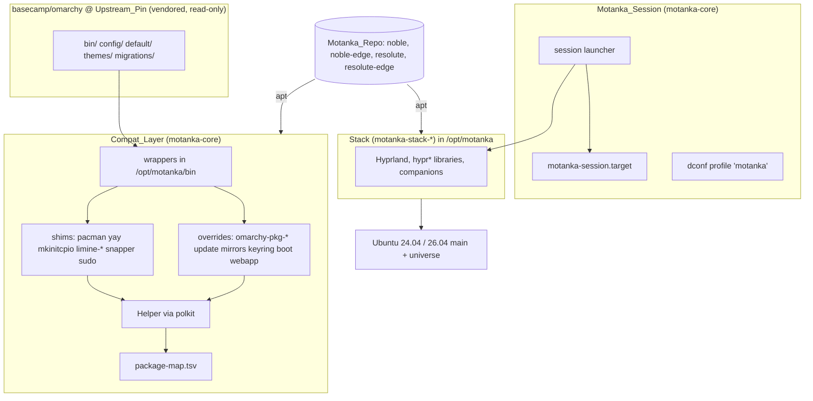
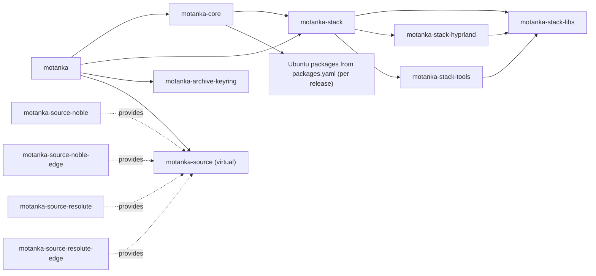
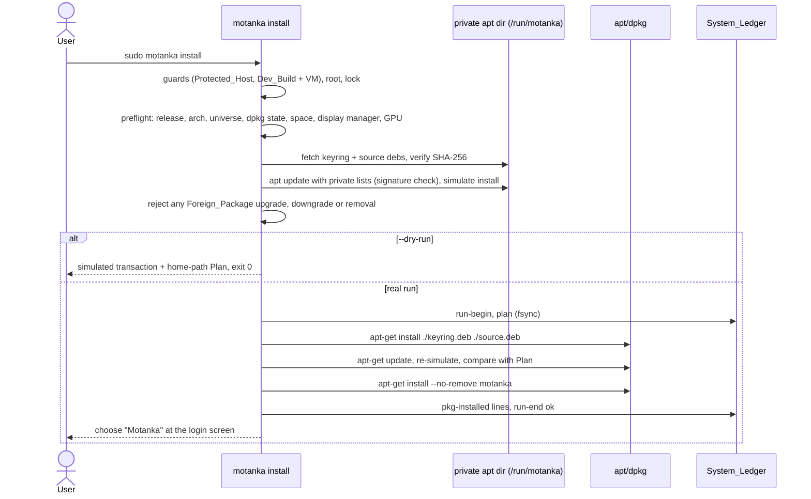
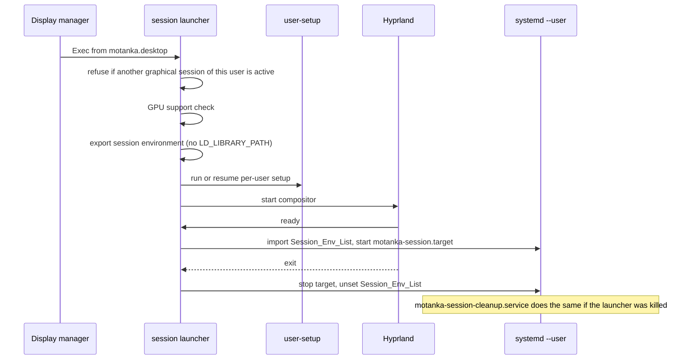
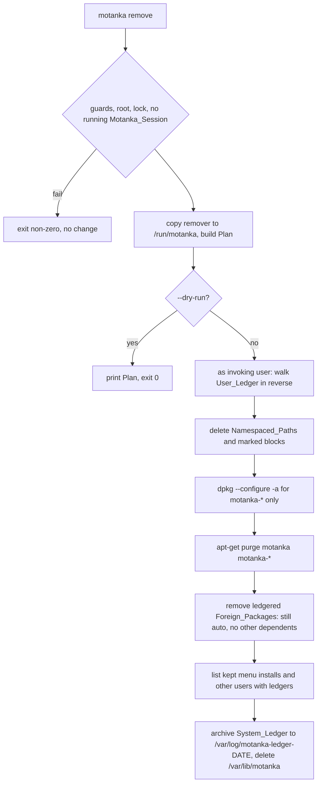
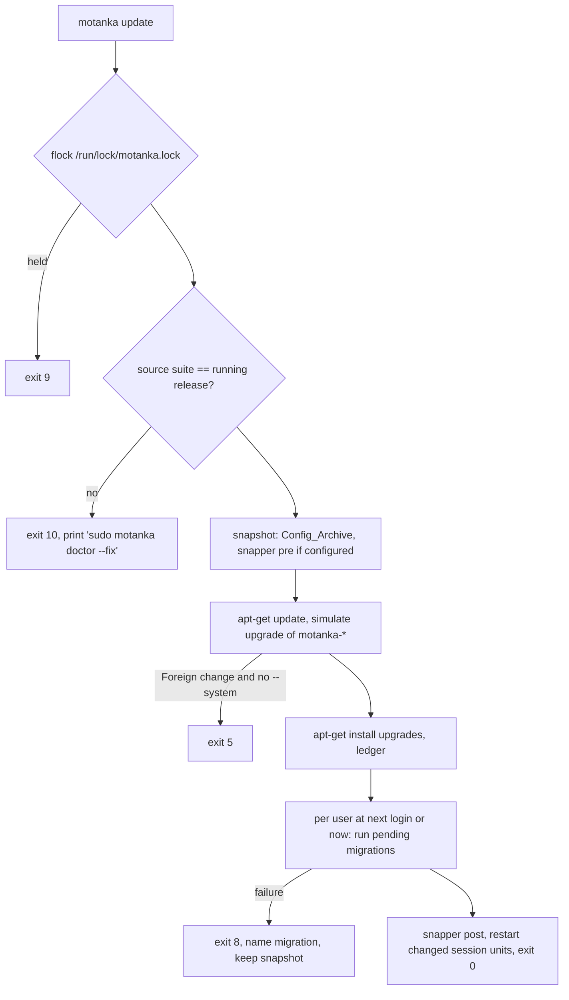

# Design Document: motanka-layer

## Overview

This design implements `requirements.md` (Requirements 1–14) on the architecture in `DESIGN.md`, including its "Linux practices" section.

- Upstream is vendored unmodified, read-only, under `/opt/motanka/share/omarchy`.
- A Compat_Layer of package map, wrappers, shims and overrides translates Upstream's Arch calls.
- The Stack ships under `/opt/motanka` and finds its libraries through RUNPATH.
- A separate Wayland session starts all of it. Its environment, services, dconf store and launchers stay inside that session.
- Every system change goes through apt and is recorded in the System_Ledger. Every planned home-folder change is ledgered before it happens, and a scan afterwards catches the rest.

Building the current Hyprland stack for Ubuntu 24.04 under `/opt/motanka` is not yet proven. Spike S1 settles it before any packaging task starts.

### Terms introduced by this design

- **Plan**: the list of actions a command computes before acting. `--dry-run` prints the Plan and stops.
- **Wrapper**: a generated launcher in `/opt/motanka/bin` for one Upstream command. It sets the wrapper scope and runs the override or the unmodified Upstream script.
- **Wrapper scope**: the environment a Wrapper sets: `PATH` with overrides, shims and Upstream `bin/` in front, and `OMARCHY_PATH`.
- **Session_Env_List**: the fixed list of variables the launcher imports into the systemd user manager and removes when the session ends.
- **Home_Path_Class**: the class of each home-folder target Upstream writes: `namespaced`, `session`, `app` or `shared`.
- **Call_Inventory**: the CI-generated list of every Arch-tool call, privileged call and home write in Upstream at a pin.
- **Config_Archive**: Motanka's snapshot: the installed Motanka .debs, their version list and a tar of each user's ledgered and Namespaced_Paths.

### Departures from DESIGN.md

| Departure | Reason |
|---|---|
| The apt source file is owned by one of four `motanka-source-<suite>` packages, not by the keyring package. | Requirement 11.2 needs a suite switch, and system files change only through dpkg. Installing a different source package does that. |
| Override files keep their Upstream names, for example `omarchy-pkg-add`. | An override works only if it shadows the Upstream name inside the wrapper scope. No name Motanka exposes contains "Omarchy". |
| Rollback restores from locally stored .debs, not from the repo. | Rollback then works offline and does not depend on the repo keeping old versions. |
| `~/.local/share/omarchy` is a symlink to `/opt/motanka/share/omarchy`. | Upstream configuration files source that path literally. The symlink is a Namespaced_Path and is ledgered. |
| `motanka-tweaks` is not part of this spec. | No requirement covers it. |

## Architecture

### Layers



### Package graph



### Install sequence



### Session start and stop



### Remove flow



### Update flow



## Components and Interfaces

### Packages

| Package | Contents |
|---|---|
| `motanka` | Metapackage. Depends on the four below. |
| `motanka-archive-keyring` | `/usr/share/keyrings/motanka-archive-keyring.gpg`, `/etc/apt/preferences.d/motanka`. |
| `motanka-source-<suite>` | `/etc/apt/sources.list.d/motanka.sources` (deb822, `Signed-By`). The four packages conflict with each other and provide `motanka-source`. |
| `motanka-stack-libs` | Hypr* libraries and any newer base libraries S1 requires, in `/opt/motanka/lib`. |
| `motanka-stack-hyprland` | Hyprland, portal backend, in `/opt/motanka/bin` and `/opt/motanka/libexec`. |
| `motanka-stack-tools` | Companion programs the Package_Map maps to `motanka` (for example hyprsunset, quickshell, walker). |
| `motanka-stack` | Metapackage for the three stack packages. |
| `motanka-core` | CLI, vendored Upstream, Compat_Layer, session files. Depends on the Ubuntu packages listed for its release in `packages.yaml`. |

Versions are `<motanka>-<rev>~ubuntu<release>.<n>`, for example `0.1.0-1~ubuntu24.04.1`. A CI check runs `dpkg --compare-versions` for every pair (11.6).

apt preferences shipped by the keyring package:

```
Package: *
Pin: release o=Motanka
Pin-Priority: -1

Package: motanka motanka-*
Pin: release o=Motanka
Pin-Priority: 500
```

### File layout

| Path | Owner | Purpose |
|---|---|---|
| `/usr/bin/motanka` | motanka-core | CLI entry point. |
| `/opt/motanka/share/omarchy/` | motanka-core | Vendored Upstream, byte-for-byte, root-owned. A build step compares it with the pinned tarball checksum (7.1). |
| `/opt/motanka/bin/` | core, stack | Wrappers and Stack programs. The only Motanka folder on the session `PATH`. |
| `/opt/motanka/libexec/motanka/shims/` | motanka-core | Shims, including the `sudo` dispatcher. |
| `/opt/motanka/libexec/motanka/overrides/` | motanka-core | Ubuntu replacements for Upstream scripts. |
| `/opt/motanka/libexec/motanka/{helper,session,user-setup,run-upstream}` | motanka-core | Helper, session launcher, per-user setup, wrapper runner. |
| `/opt/motanka/share/motanka/` | motanka-core | `package-map.tsv`, `home-paths.tsv`, `migrations.tsv`, `session-env.list`, `upstream.pin`, `stack-versions.tsv`, `DEV_BUILD` (dev builds only). |
| `/usr/share/wayland-sessions/motanka.desktop` | motanka-core | Session entry: `Exec=/opt/motanka/libexec/motanka/session`, `DesktopNames=Motanka;Hyprland`. |
| `/usr/lib/systemd/user/motanka-*.{service,target}` and `motanka-session.target.wants/` | motanka-core | User units, wired by package-owned symlinks. |
| `/usr/share/polkit-1/actions/org.motanka.policy` | motanka-core | Action `org.motanka.packages`, `auth_admin_keep`. |
| `/etc/dconf/profile/motanka`, `/etc/dconf/db/motanka.d/` | motanka-core | Profile `user-db:motanka` + `system-db:motanka`, and defaults. The compiled `/etc/dconf/db/motanka` is removed in `postrm purge` (3.13). |
| `/usr/share/xdg-desktop-portal/motanka-portals.conf` | motanka-core | Portal selection for desktop name `Motanka`. |
| `/etc/apparmor.d/motanka-*` | stack | Profiles granting `userns` to Stack programs that need it (8.7). |
| `/var/lib/motanka/` | runtime | System_Ledger, snapshots. Not dpkg-owned; removed by the Remover and by `postrm purge`. |

A package check in CI lists every path in every .deb and fails on any path outside this table, on any setuid, setgid or capability bit, and on any file under `/etc/ld.so.conf.d`, `/etc/sudoers.d`, `/etc/profile.d` or `/etc/sysctl.d` (3.3, 3.4, 3.11, 3.12, 5.3, 8.8).

### CLI

```
motanka install  [--dry-run] [--yes] [--channel stable|edge]
motanka remove   [--dry-run] [--yes] [--purge]
motanka update   [--dry-run] [--yes] [--system]
motanka rollback [--dry-run] [--yes]
motanka doctor   [--json] [--fix]
```

`--i-know-this-is-not-a-vm` is accepted by `install`, `remove`, `update` and `rollback` on a Dev_Build only. `NO_COLOR` is honoured. The first install uses `install.sh` from a GitHub release, which is the same Installer code; its checksum is published next to it.

| Exit code | Meaning |
|---|---|
| 0 | Success. |
| 1 | Unexpected error. |
| 2 | Usage error. |
| 3 | Unsupported host: release, architecture or `universe`. |
| 4 | Preflight failed: dpkg state, free space or display manager. |
| 5 | A Foreign_Package would change. |
| 6 | Checksum or signature verification failed. |
| 7 | Guard refused: Protected_Host, or Dev_Build outside a VM. |
| 8 | Migration failed. |
| 9 | Lock held by another Motanka process. |
| 10 | Repo suite does not match the running release. |
| 11 | Authorisation denied. |
| 12 | Session refused: unsupported GPU driver or another graphical session active. |

All commands log to the journal with `SYSLOG_IDENTIFIER=motanka`. Log lines carry paths and package names, never file contents (12.5, 12.6).

### Wrappers, shims and the Helper

- At build time one Wrapper is generated per file in Upstream `bin/`. A Wrapper runs `run-upstream <name> "$@"`.
- `run-upstream` sets `OMARCHY_PATH=/opt/motanka/share/omarchy` and `PATH=<overrides>:<shims>:<upstream bin>:$PATH`, then runs `overrides/<name>` if it exists, otherwise Upstream `bin/<name>`. Shims are therefore visible only below a Wrapper (5.9, 7.14).
- `pacman` and `yay` shims translate:

| Call | Action |
|---|---|
| `-S [--needed] [--noconfirm] <pkgs>` | Map each name, then `helper install`. |
| `-R`, `-Rns <pkgs>` | `helper remove` for names in a ledger; others are logged and skipped. |
| `-Q`, `-Qq`, `-Qi <pkg>` | `dpkg-query` on the mapped name; exit 1 if absent. |
| `-Sy`, `-Syu` | No package change; exit 0. Updates belong to `motanka update`. |
| anything else | Log to the journal, exit 64 (7.5). |

- `mkinitcpio`, `limine-*` and `snapper` shims log the call and exit 64. Scripts that need them are overrides (7.8).
- The `sudo` dispatcher skips sudo's own options, and if the command name is a shim it runs the shim unprivileged. Anything else is passed to `/usr/bin/sudo` unchanged.
- The Helper is run as `pkexec /opt/motanka/libexec/motanka/helper <install|remove> <names…>`. It:
  - accepts a name only if it is an outcome in `package-map.tsv` for the running release, or is in a ledger (7.12);
  - simulates the apt transaction and refuses with exit 5 if a Foreign_Package would change version or be removed;
  - runs `apt-get install --no-remove` or `apt-get remove`, and writes `menu-install` lines with `PKEXEC_UID` to the System_Ledger (7.7);
  - exits 11 without changes when polkit denies (7.13).
- Package_Map outcomes: `apt` (Ubuntu package), `motanka` (Motanka_Package), `flatpak` (installed with `--user`, ledgered in the User_Ledger), `binary` (download, verify SHA-256, install under `/opt/motanka` through the Helper or under a Namespaced_Path; 4.8, 4.9), `skip` (exit 0, print reason; 7.6).
- The web-app override adds `OnlyShowIn=Motanka;` to every desktop entry it writes and ledgers it (5.13).

### Session

- Launcher steps: concurrent-session check through `loginctl` (5.12), GPU check (8.6), environment, per-user setup, compositor, target start, cleanup.
- Session environment: `XDG_CURRENT_DESKTOP=Motanka:Hyprland`, `XDG_SESSION_DESKTOP=motanka`, `DCONF_PROFILE=motanka`, `PATH=/opt/motanka/bin:$PATH`, `XDG_DATA_DIRS=/opt/motanka/share:$XDG_DATA_DIRS`, `OMARCHY_PATH`. `LD_LIBRARY_PATH` is never set (5.14).
- `motanka-session.target`: `BindsTo=graphical-session.target`, `Before=graphical-session.target`. Motanka units are `PartOf=motanka-session.target` and are pulled in only by `motanka-session.target.wants/` symlinks (5.4, 5.5).
- `motanka-session-cleanup.service` runs `systemctl --user unset-environment` for the Session_Env_List when the target stops, so cleanup also happens if the launcher is killed (5.11).
- Autostart entries shipped by Motanka carry `OnlyShowIn=Motanka;` (5.8).
- Whether to ship `uwsm` in the Stack and let it run the session is decided by Spike S2. The interface above holds either way.

### Per-user setup

1. Take the per-user lock, write `setup-begin`, create a time marker file.
2. For each target in the vendored `config/` tree, look up its Home_Path_Class in `home-paths.tsv`:
   - `namespaced`: write.
   - `session` (for example `~/.config/hypr`, `waybar`, `walker`): ledger, back up if present, write by temp-file-and-rename (6.2, 6.3, 6.11).
   - `app` (for example `~/.config/alacritty`, `btop`): same as `session`, but skipped with a notice when the file already exists.
   - `shared`: skipped. With opt-in shell integration, one marked block is added to the chosen rc file (6.5, 6.6).
3. Create the `~/.local/share/omarchy` symlink and the dconf user database `~/.config/dconf/motanka`.
4. Run Upstream per-user scripts that the Call_Inventory marks safe, through Wrappers.
5. Scan `~/.config`, `~/.local` and top-level dotfiles with `find -newer <marker>`. Any path not in the ledger and not under a Namespaced_Path is ledgered as `unplanned` (6.9, 6.10).
6. Write `setup-end`. A login that finds `setup-begin` without `setup-end` resumes from the last ledgered step (6.7).

### Updater, snapshots and rollback

- Snapshot: `/var/lib/motanka/snapshots/<id>/` holds `manifest.tsv` (package, version), the installed Motanka .debs copied from the apt cache or rebuilt with `dpkg-repack`, and `user-<uid>.tar.zst` per user with a ledger. The last 3 snapshots are kept (9.10).
- If `snapper list-configs` shows a config for `/`, the Updater runs `snapper create --type pre` and `--type post` (9.12).
- Migrations run per user through the migrate override, which reads `migrations.tsv`: `ok` runs the Upstream script through a Wrapper, `override` runs the file of the same name from `overrides/migrations/`, `n/a` is recorded as done without running. State is written in Upstream's format under `~/.local/state/omarchy/migrations/` (9.6, 9.7).
- `motanka rollback` installs the .debs of the latest snapshot with `apt-get install ./…deb` and restores the user archive for the invoking user (9.9).

### Doctor

- Reports release, Motanka version, channel, Upstream_Pin, Stack versions, GPU driver, display manager, snapshot method, features unavailable on this release with reasons, ledgered paths missing or changed, unplanned entries, and unsupported shim calls from the journal for the last 30 days (1.7, 12.1–12.3, 12.8).
- `--json` prints one JSON document with the same fields (12.7).
- `--fix` is the only mode that changes anything. Its one system action is installing the `motanka-source-<suite>` package that matches the running release (11.2, 12.4).

### Guards

- Protected_Host: if `/etc/motanka-protected` or the invoking user's `~/.config/motanka-protected` exists, `install`, `remove`, `update` and `rollback` exit 7 before anything else (14.11).
- Dev_Build: if `DEV_BUILD` exists and `systemd-detect-virt` prints `none`, the same commands exit 7 unless `--i-know-this-is-not-a-vm` is given (14.8).

### Motanka_Repo (chumak)

- Static repository: `dists/<suite>/{InRelease,Release,main/binary-amd64/Packages*}` with `by-hash/`, and `pool/`. Origin `Motanka`.
- `InRelease` is signed in CI with a signing subkey; `Valid-Until` is 14 days and a scheduled job re-signs weekly (4.2, 4.7).
- A version is copied into `noble` and `resolute` in one publish step, only after CI passed for both (1.2, 13.8).

### VM test harness

| Command | Behaviour |
|---|---|
| `test/vm/image <release> <variant>` | Download the Ubuntu cloud image, verify it against the signed `SHA256SUMS` with `gpgv`, provision the variant, store the base image in `~/.cache/motanka-vm/base/`. |
| `test/vm/up <release> <variant>` | Create a qcow2 overlay, start `qemu-system-x86_64 -enable-kvm` with user-mode networking, SSH forwarded to a free port on 127.0.0.1, and cloud-init seeded over NoCloud HTTP from a server bound to 127.0.0.1. Print the VM name. |
| `test/vm/run <name> -- <cmd>` | Run a command over SSH with a key generated under `~/.cache/motanka-vm/`. |
| `test/vm/push <name>` | `rsync` the repository into the VM. |
| `test/vm/fingerprint <name> <label>` | Capture the Fingerprint into `~/.cache/motanka-vm/fp/<name>/<label>/`. |
| `test/vm/down <name>` | Stop the VM and delete the overlay. |
| `test/run-all [--release noble]` | Lint, unit tests, then VM tests. |

- The harness refuses to start if `/dev/kvm` is not readable and writable by the user (14.10). It never calls `sudo` and never passes `--i-know-this-is-not-a-vm` (14.5, 14.9).
- No host folder is shared into a VM (14.7).
- Packages are built inside a build VM with `sbuild`, one chroot per release.

## Data Models

**System_Ledger** `/var/lib/motanka/ledger`, one tab-separated line per event, appended and fsynced:

```
<utc-time>  <run-id>  <verb>  <fields…>
run-begin        install|update|remove  <motanka-version>
plan             <apt simulation line>
pkg-installed    <name>  <version>  auto|manual
menu-install     <uid>  <name>  apt|binary
run-end          ok|failed
```

**User_Ledger** `~/.local/state/motanka/ledger`:

```
<utc-time>  <run-id>  <verb>  <class>  <path>  <sha256-before|->  <sha256-after|->  <backup-id|->
verbs: setup-begin, create, replace, symlink, block, menu-desktop, unplanned, setup-end
```

Backups are stored at `~/.local/state/motanka/backups/<backup-id>/<path>`.

**packages.yaml** (source) and **package-map.tsv** (compiled per release):

```yaml
fd:
  noble:    {apt: fd-find}
  resolute: {apt: fd-find}
hyprsunset:
  all:      {motanka: motanka-stack-tools}
localsend:
  all:      {binary: {url: "…", sha256: "…", dest: /opt/motanka/apps/localsend}}
limine:
  all:      {skip: "bootloader is out of scope"}
```

```
<arch-name>  <kind>  <target>  <sha256-or-reason>
```

**Other files**

| File | Format |
|---|---|
| `upstream.pin` | `<channel>  <commit>  <tag-or-->  <tarball-sha256>` |
| `stack-versions.tsv` | `<component>  <version>  <source-url>  <sha256>` |
| `migrations.tsv` | `<migration-id>  ok|override|n/a  <note>` |
| `home-paths.tsv` | `<glob>  namespaced|session|app|shared` |
| `session-env.list` | one variable name per line |
| `compat/inventory/<pin>.tsv` | `<file>  <line>  arch-tool|privileged|home-write  <detail>` |

**Fingerprint** is a folder of text files: `packages.tsv`, `manual.txt`, `etc.sha256`, `units.txt`, `dconf-<user>.ini`, `home-<user>.sha256`, `snaps.txt`, `groups.txt`, `sysctl.txt`, `sessions.txt`. The comparison tool applies the Allowlist and prints remaining differences.

## Error Handling

| Criterion | Detection | Response |
|---|---|---|
| 1.4 | `/etc/os-release` `ID` and `VERSION_ID` | Exit 3, print detected release. |
| 1.5 | `dpkg --print-architecture` | Exit 3. |
| 1.6 | `apt-cache policy` shows no `universe` | Exit 3, print `sudo add-apt-repository universe`. |
| 2.4 | `dpkg --audit`, `apt-get check` | Exit 4, print the affected packages. |
| 2.5 | `df --output=avail /` under 4 GB | Exit 4. |
| 2.6 | Simulation lists `Inst`/`Remv` for a Foreign_Package already installed | Exit 5, list them. |
| 2.7 | Display manager unknown, or Wayland disabled in its configuration | Exit 4, name it. |
| 3.9 | Every ledger line is written and fsynced before its action | Ledger is complete up to the interruption; rerun or remove both work. |
| 4.5 | `sha256sum`, apt signature check in the private apt folder | Exit 6 before any install. |
| 4.9 | SHA-256 mismatch on a `binary` outcome | Delete the download, exit 6. |
| 5.12 | `loginctl` shows another active graphical session for the user | Exit 12 with a message in the journal. |
| 6.7 | `setup-begin` without `setup-end` | Resume at next login. |
| 6.10 | Post-setup scan | Ledger as `unplanned`; Doctor reports it; CI fails. |
| 7.5 | Unsupported shim operation | Journal entry, exit 64. |
| 7.6 | `skip` outcome | Print reason, exit 0. |
| 7.9 | CI compares Upstream package lists with `packages.yaml` | Pin bump fails. |
| 7.10 | CI diffs each overridden Upstream file between pins | Pin bump fails until `compat/reviewed/<pin>` lists the file. |
| 7.13 | `pkexec` returns 126 or 127 | Exit 11, no package change. |
| 8.6 | GPU driver not in the supported list | Exit 12 with the reason in the journal. |
| 9.8 | Migration exits non-zero | Stop, exit 8, name it, keep the snapshot. |
| 9.11 | `flock -n` fails | Exit 9. |
| 11.5 | Suite in `motanka.sources` differs from `VERSION_CODENAME` | Exit 10, print `sudo motanka doctor --fix`. |
| 13.7 | Round-trip or isolation job fails | Publish job does not run. |
| 14.8 | `DEV_BUILD` present and `systemd-detect-virt` is `none` | Exit 7. |
| 14.10 | `/dev/kvm` not usable | Harness exits non-zero and names the `kvm` group. |
| 14.11 | Protected_Host marker present | Exit 7, regardless of flags. |

## Testing Strategy

- **Lint**: `shellcheck`, `shfmt -d`, `lintian` on every package, the package path check above.
- **Unit tests (`bats-core`, host-safe, temp folders only)**:
  - shim argument translation, including the `sudo` dispatcher;
  - `packages.yaml` validation and compilation;
  - version ordering between releases;
  - ledger property: for any generated sequence of create, replace and block actions on a temp home, applying then reverse-walking restores the original tree byte for byte, including after truncating the sequence at any point;
  - Helper name validation: for any name not in the map or a ledger, the Helper refuses.
- **VM tests (26.04 by default, `--release noble` for 24.04)**:
  - round trip on each image variant: fingerprint, install, first login, theme switch, menu install, web app, update, isolation fingerprint from an Other_Session, remove, fingerprint compare (13.1–13.3);
  - apt simulation on each variant (13.5);
  - interrupted install, offline removal, removal after release upgrade (13.4);
  - concurrent-session refusal, environment cleanup after logout, shim invisibility from an interactive shell;
  - release upgrade 24.04 → 26.04 with Motanka installed (11.1–11.4).
- **Parity**: one probe script (`hyprctl binds -j`, selected options, which Upstream commands exit 0 with `--help` or a dry action, theme outputs, `Hyprland --verify-config`) on a reference Arch VM at the same pin and on Motanka; the difference is published (13.6).
- **Session in a VM**: the desktop variants log in automatically to the Motanka session; tests reach it over SSH. Spike S3 decides between `virtio-vga-gl` with `egl-headless` and software rendering.

## Requirements Coverage

| Requirement | Components |
|---|---|
| 1 Supported releases | Preflight, per-release builds, single publish step, Doctor feature list. |
| 2 Preflight and dry run | Installer preflight, private apt simulation, Plan. |
| 3 Additive installation | Package layout and path check, `--no-remove`, System_Ledger, purge scripts. |
| 4 Repository trust | Keyring package, apt pin, signed `InRelease` with `Valid-Until`, binary checksums. |
| 5 Session isolation | Session entry, launcher, target wiring, cleanup unit, dconf profile, `OnlyShowIn`, Wrapper scope. |
| 6 Per-user setup | `user-setup`, `home-paths.tsv`, User_Ledger, post-setup scan. |
| 7 Compatibility layer | Vendored tree check, Package_Map, Wrappers, shims, overrides, Helper, CI pin-bump gates. |
| 8 Platform stack | `motanka-stack-*`, RUNPATH, GPU check, AppArmor profiles. |
| 9 Rolling updates | Updater, Config_Archive, migrate override, `migrations.tsv`, pin-bump bot, lock. |
| 10 Removal | Remover, reverse ledger walk, ledgered Foreign set, `/run` self-copy. |
| 11 Release upgrade | Version scheme, `motanka-source-<suite>`, Doctor `--fix`, suite check. |
| 12 Diagnostics | Doctor, journal logging. |
| 13 Verification | CI jobs, Fingerprint tool, parity probe, publish gate. |
| 14 Test isolation | VM harness, guards. |

## Open Questions and Spikes

**Spikes, in order. Each runs in a test VM and ends with a written result in this file.**

- **S1 — Stack on 24.04.** Build Hyprland at the pinned version for `noble` under `/opt/motanka`. Compare: (a) native build per release with newer base libraries bundled; (b) rebuilding 26.04 or Debian packaging with a changed prefix; (c) a newer compiler with `libstdc++` shipped in `/opt/motanka/lib` or linked statically; (d) one build on 24.04 shipped to both suites. Record which host libraries must be bundled and the resulting package size. If none works within the rules, 24.04 support needs a decision from the owner.
- **S2 — Upstream inventory.** Generate the Call_Inventory for the current pin: hardcoded `~/.local/share/omarchy` paths, `sudo` and Arch-tool calls, `systemctl --user enable` calls, writes to Shared_Files, and use of `uwsm`. Decide whether the Stack ships `uwsm`, and list the overrides needed.
- **S3 — Hyprland in QEMU.** Confirm a Motanka-independent Hyprland session starts in the test VM without host privileges, and choose the graphics device.
- **S4 — Release upgrade.** Run `do-release-upgrade` 24.04 → 26.04 in a VM with placeholder `/opt` packages and a third-party source, and record what the upgrader does to both.
- **S5 — Display managers.** Confirm GDM on both releases and SDDM list a session with `DesktopNames=Motanka;Hyprland` and pass the names through.

**Decisions by the owner (2026-11-12)**

1. The repo is hosted on GitHub Pages with packages as release assets. The primary signing key stays offline; CI signs with a subkey.
2. NVIDIA is supported in the first release, for driver version 555 or later (8.9). It cannot be tested in the VMs, so each published version needs a recorded manual hardware test (13.9).
3. `flatpak` outcomes may install Flatpak itself through the Helper as a ledgered dependency (7.15). Apps are installed with `--user`.
4. The first login asks once whether to enable shell integration (6.12). Declining leaves every shell rc file untouched.
